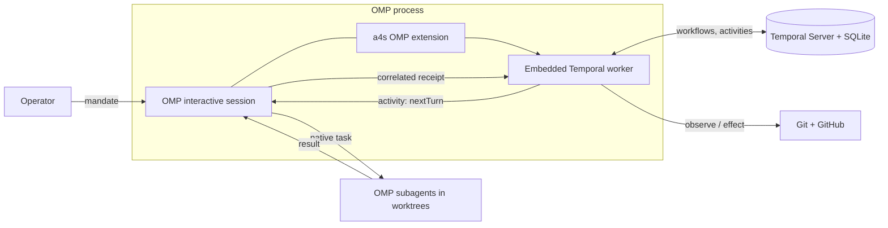

# OMP + Temporal architecture and roadmap

## Status

This is the canonical architecture and roadmap for a4s. It supersedes every other
document under `docs/` and `README.md` wherever they conflict. Those documents
describe the previous line and stay in place only until the cutover (step 1)
decides their fate.

- `legacy2` (remote) preserves the complete previous `main` at `dde6f44`.
- The remote branch `chore/v1-sync-main-0.3.118` was deleted.
- Dagu is not part of this architecture. T3 is not the target host. OmO
  (oh-my-openagent) is not adopted: its license (Sustainable Use License) and
  unproven portability rule it out as the base host.

## Goal

Sustained completion of an authorized objective across many work items without
repeated operator prompts. An objective names its repository, outcome,
observable acceptance checks, a finite work-selection rule, permissions and stop
conditions. Findings, issue text and agent output are data, not authority.

## Architecture

| Component | Decision |
| --- | --- |
| Host | Official compiled OMP binary, interactive session. No headless agents. |
| Controller | An OMP extension embeds a Temporal TypeScript worker. Workflows own every authoritative transition; activities perform observations and effects. |
| Workflows | One objective workflow (finite selection, dependencies, successor dispatch). Item workflows (stages, waits, bounded repair). |
| Agent handoff | An activity asks the main agent for a turn via `nextTurn`. The main agent runs native `task` subagents; the bridge correlates their result into a receipt. The extension never calls `task` directly. |
| Workflow runtime | Self-contained prebuilt bundles (extension, worker thread, native addon, WASM) loaded via `workflowBundle`, `debugMode: false`, `TEMPORAL_DEBUG` unset. Exact SDK pin; bundling patches SDK load sites and is re-reviewed on every SDK update. |
| Persistence | Temporal Server binary under systemd with SQLite default and visibility stores, single host, localhost/private bind, separate from OMP lifetime. Not `start-dev`. PostgreSQL only after observed need. |
| Evidence | Activities validate receipts and external state independently, bound to mandate, item, stage, attempt and exact Git revision. Agent completion text is never gate evidence. Unknown effect outcomes are reconciled before any retry. |
| Isolation | One worktree per modifying item, with a fenced lease (generation) for its owning worker. Stale owners are rejected at dispatch, result acceptance and effects. |
| Integration | Trunk-based: tested candidate -> local merge into trunk -> gate on integrated revision -> non-force push -> observed closure and cleanup. |
| Process lifecycle | A supervisor resumes the persisted OMP session after abnormal exit and does not relaunch after normal exit. A lost child gets a new bounded attempt. |
| Reuse source | [pi-temporal](https://github.com/temporalio/pi-temporal) intent/result persistence, fencing and session bridge are adapted before writing bespoke code. |

Item states: `pending`, `ready`, `running`, `retry_wait`, `blocked`,
`succeeded`, `failed`, `cancelled`. Every nonterminal run has executing work, an
executable scheduled wait, or a named external blocker. Idle is never completion.

## Baseline evidence (step 2, done)

The base tests ran on the local branch `architecture/temporal-omp`. Their code and
evidence live, **uncommitted**, under `poc/temporal-omp/` in that working tree
(`/home/shared/harness/a4s`), indexed by `poc/temporal-omp/evidence-index.json`.
The previous long-form contract is `docs/architecture/execution-architecture.md`
in that same working tree.

| Slice | Observed | Open (becomes backlog, not more probes) |
| --- | --- | --- |
| SQLite runtime | Server 1.32.2 + SQLite stores + SDK 1.25.0; run result and history readable after graceful restart. | systemd operation, backup/restore, crash/power loss. |
| OMP compatibility | Compiled OMP 18.16.0: UI -> embedded worker -> `nextTurn` -> native `task` -> correlated result -> workflow completion. | Async task completion; Linux x64 addon only. |
| Objective succession | Two dependent native items, one command item and a named blocker; automatic successor across turn end, `session_compact` and same-version `/restart`. | Crash between send marker and `sendMessage`; child loss. |
| Safety | 19 Git/receipt cases incl. commit/push result loss without repeating the effect. | Atomic authority + effect; real backend concurrency. |
| Ownership | Owner SIGKILL, fenced takeover, SQLite-fenced receipt acceptance, duplicate and wrong-mandate rejection. | Native OMP supervisor/session recovery. |
| Update | Compatible workflow v1 -> v2 continuation with an old activity in flight. | Extension self-update; incompatible workflow changes. |

Rule: no further probes are added to this set. Every open column item is
handled as a normal backlog item in step 4, when real delivery needs it.

## Roadmap

### Step 0 - Inventory research (prerequisite)

Decide exactly what stays, what is updated and what goes, with evidence, before
any deletion or backlog change. Scope:

- Repository content of `legacy2`: packages (`issue-lifecycle`, `launcher`,
  `agent-messaging`, `kiro-omp-provider`, `context-management`,
  `orca-integration`, `loader`, `review-routing`, `pi-tool-row-presentation`,
  `hot-reload`), `apps/message-bus`, `skills/`, `.omp/agents`, `docs/`,
  `poc/hot-loader`, build/test/CI configuration.
- `poc/temporal-omp/` slices: which become production components, which stay as
  reference evidence only.
- Installed station state (`dagu.service`, `a4s` CLI, skills installed in OMP):
  what is retired and in which order.
- GitHub: 68 open issues, 8 milestones, trackers (#882, #918 and others).

Output: one keep/update/remove table per area, and the ordered backlog proposal
consumed by steps 1 and 3. The research is read-only.

### Step 1 - Cutover

Remove from `main` everything step 0 marks as removed, bring in the components it
marks as kept or promoted, and leave `main` building and testing green. No
compatibility shims; `legacy2` is the only record of removed code.

### Step 2 - Baseline tests

Done; see the evidence table above.

### Step 3 - Backlog alignment

Close, rewrite or create issues, milestones and trackers so that GitHub matches
this architecture and the build order of step 4. Uses the step 0 table.

### Step 4 - Incremental self-hosted development

Each issue is delivered with the components delivered by the previous ones:

- Issue 1 is done bare: operator plus OMP session.
- Issue N runs on the components of issues 1..N-1.
- Any step not yet automated is done manually and recorded as such, never hidden.
- Order follows autonomy: first what executes an issue end to end, then what
  makes it safer. Indicative order: worker + `nextTurn`/`task` dispatch as a real
  component; gates (build, test, review); local merge and push; next-item
  selection; crash recovery and self-update.
- Something is built only when it blocks a real delivery. Sophistication without
  delivery is the failure mode to avoid.
