# Dagu feature lifecycle

Carry one GitHub issue from feasibility triage to a merged PR through durable Dagu runs. The repository owns `.workspace/dagu/dags/feature.yaml` and `.workspace/dagu/dags/poc.yaml`, rendered from this skill. A user-level Dagu service runs them in the same repository queue.

```mermaid
flowchart LR
    T[triage<br/>human.task<br/>coordinator reviewer] --> TD[triage_decision]
    TD -->|POC=yes: enqueue and finish| P[poc]
    TD -->|POC=no + REVIEW| A[start_gate]
    A --> AS[recover_start_gate]
    AS -->|healthy: skipped| B[implement<br/>human.task<br/>issue subagent]
    AS -->|operator repair: push-back| A
    B --> CP[capture<br/>Dagu commit] --> C[checkpoint_push]
    C --> N[dependency_review]
    N -->|new dependencies: push-back| T
    N -->|reviewed dependencies| D[rebase]
    D --> R[conflict_review<br/>human.task]
    R -->|conflict: push-back| B
    R -->|clean rebase| E[gate]
    E --> ER[recover_gate]
    ER -->|code failure: push-back| B
    ER -->|healthy: skipped| Q[quality_prepare<br/>current SHA request]
    Q --> QR[quality_review<br/>independent QA + reviewer]
    QR --> V[quality_admit<br/>runtime provenance]
    V --> QT[quality_transition]
    QT -->|FAIL findings: push-back| B
    QT -->|two current PASS| F[push]
    F --> FR[recover_push]
    FR -->|operator repair: push-back| F
    FR -->|healthy: skipped| G[pr]
    G --> I[auto_merge]
    I --> J[await_merge<br/>human.task<br/>queue slot released]
    J -->|MERGED: complete| K[close_gate]
    J -->|BEHIND or DIRTY: push-back| D
    K --> L[handler_on.exit cleanup]
```



## Requirements

- `dagu` on `PATH`, and a user-level service running `dagu start-all`. Check with `dagu version` and `launchctl list | grep -i dagu` (macOS) or `systemctl --user status` (Linux).
- `@a4s/omp-dagu` loaded in the coordinating OMP session; its `dagu_session_id` tool identifies the session and its status extension delivers targeted checkpoint notices.
- `dagu-feature-bundle` from this package on the Dagu service's `PATH`, so internal feature/PoC/discovery promotions pass the same admission boundary as the coordinator.
- `DAGU_HOME` in your shell must point to the same home as that service. Read it from the service definition (macOS: `EnvironmentVariables.DAGU_HOME` in the LaunchAgent plist). If they differ, enqueue and complete commands land in a store the scheduler never reads, and the run stays `Queued`.
- `git`, `gh` authenticated with push and PR rights, `curl`, `jq`.
- The tools the repository's gate command needs.

Install the Dagu binary separately at the version pinned in `../../package.json`.
Everything that varies between repositories is a DAG param.

## Global station installation

a4s owns the macOS service template and shared defaults in `../../dagu/`.
From a clean primary checkout after merge, the operator creates or updates the
installation with Node.js >=22.19.0 and the expected `dagu` on `PATH`:

```sh
package="$PWD/packages/omp-dagu"
export DAGU_HOME="$HOME/.dagu"
node "$package/bin/dagu-station-install.ts" \
  --launch-agent "$HOME/Library/LaunchAgents/local.dagu.server.plist" \
  --log-dir "$HOME/Library/Logs/Dagu"
```

The installer checks `dagu version` against `daguFeature.dagu` (2.20.1), validates
a minimal DAG inheriting the versioned base in an isolated temporary home, and
checks the rendered plist with `plutil` on macOS before installing. `cmp` and
`install -m 0644` make repeated installs byte- and mtime-stable. `base.yaml` and
the rendered plist are fully owned; `config.yaml` merges only the leaves in the
versioned `dagu/config.yaml` (`auth.mode`, `queues.enabled`, `host`, `port`,
`coordinator.enabled`). Other leaves, comments and `queues.config`, including
other repositories' concurrency limits, remain owned by their original writers.
Foreign paths stay untouched during validation. The plist captures the
operator's current `PATH` and resolved Dagu binary; use the same environment on
updates. With a custom `DAGU_HOME`, the default plist destination is
`$DAGU_HOME/LaunchAgent.plist`, so a temporary-home install stays isolated.

Repeat the same command with `--check` to compare all three desired files:
exit 0 means byte-identical, exit 1 reports drift or a validation/version error.
`cmp "$package/dagu/base.yaml" "$DAGU_HOME/base.yaml"` also compares the base
directly. Config is a merge and plist is a render, rather than raw template copies.

Service activation is an operator action. For an already loaded service, at a
safe point after reviewing active runs, use `launchctl bootout
"gui/$(id -u)/local.dagu.server"`, then `launchctl bootstrap "gui/$(id -u)"
"$HOME/Library/LaunchAgents/local.dagu.server.plist"` and `launchctl kickstart
"gui/$(id -u)/local.dagu.server"`. A first installation starts with `bootstrap`.
Observe `launchctl print "gui/$(id -u)/local.dagu.server"` (`state = running`),
`curl -fsS http://127.0.0.1:8080/api/v1/health` (`healthy`) and the installer's
`--check` before repository bootstrap.

## Global history retention

The versioned global configuration in [`../../dagu/base.yaml`](../../dagu/base.yaml)
sets `hist_retention_days: 7`. The operator installs it as
`$DAGU_HOME/base.yaml` (default `~/.dagu/base.yaml`). After Dagu's retention
cleanup, runs older than seven days are no longer queryable through
`dagu history` or available for `dagu retry`. Preserve evidence needed for
longer outside the run history; recovering that work requires a new run.

## Bundle identity and compatibility

Every rendered DAG starts with
`# dagu-feature-bundle: @a4s/omp-dagu@<version> source=<owner/name>@<sha40> bootstrap=<run> dagu=<version>`
and carries the label `dagu-feature-bundle=<version>`. `start_gate` and PoC
`base` print the same bundle, source and bootstrap identity into the run log.
Identify an installed bundle directly from that header and label, from repository
history, or across indexed session history:

```sh
git log --format='%h %(trailers:key=Dagu-Feature-Bundle,valueonly)' -- .workspace/dagu/dags
git log -G '^# dagu-feature-bundle:' -p -- .workspace/dagu/dags
backscroll search dagu-feature-bundle --all-projects
```

PRIMARY runs the default branch at exactly `origin/$BASE_BRANCH`. Feature
`admit` fetches and fast-forwards a clean primary on that branch before claiming
resources; PoC `base` does the same. A remaining SHA difference fails with
`cause=primary_behind|primary_ahead`; a different package manifest version fails
with `cause=version_stale`. Diagnostics include observed/expected SHAs and
versions. Repositories distributing `packages/omp-dagu/package.json` must keep
that manifest identical in version to origin.

Admission requires the loaded extension and stamped DAG bundle to have exactly
the same version, including patch. Run notices classify bundle versus extension
by major/minor: equal major/minor is `ok` even when the patch differs, different
major/minor is `incompatible`, and a missing bundle label is `unstamped`.

Notices also compare the loaded extension against primary main when
`PRIMARY/packages/omp-dagu/package.json` exists. `stale` means this applicable
main version differs from the loaded extension, or its manifest is unreadable
or invalid. Consumer repositories without that manifest report `main=n/a`;
an unreadable or invalid manifest reports `main=unknown`. Without PRIMARY,
notices report `main=unknown` and classify only bundle versus extension.
`[DAGU STATE]` prints `bundle=`, `extension=`, `main=<version|unknown|n/a>` and
`compat=ok|stale|incompatible|unstamped`.

A stale notice raises a `warning` notification with restart/re-seal instructions
while the coordinator keeps working in the current turn. The operator restarts
OMP to load the deployed package, finishes the bootstrap re-seal and adopts its
stamped renders.

Admission requires exact versions across the package, rendered DAG, installed
reconciler and loaded extensions. The coordinating extension rewrites literal `dagu enqueue` bash
calls to the package's admission CLI, preserving shell argument expansion;
internal promotions invoke `dagu-feature-bundle enqueue` directly. Bootstrap is
the deployment procedure and remains available to repair an installation.

Before Dagu creates a run, admission verifies the unique header/label, required
Dagu version, readable realpaths and SHA-256 identities, source commit/package
version and source-to-render provenance. Incompatible or indeterminate identities
exit nonzero with `DAGU_ADMISSION_REJECTED`, observed/expected components and the
bootstrap/adopt/reload corrective action. Reload OMP after redeploying extensions.

For an operator outside OMP, use the same boundary explicitly:

```sh
node /real/checkout/packages/omp-dagu/bin/dagu-feature-bundle.ts enqueue \
  --run-id <repo>-issue-<n> .workspace/dagu/dags/feature.yaml -- ISSUE=<n> PRIMARY=<primary>
```

`admit` accepts the same arguments, reserves the run ID and emits its receipt
without calling Dagu (use a dedicated verification run ID). `enqueue` admits,
persists and enqueues the exact snapshot bytes under their original DAG name.
The receipt is `$(git rev-parse --path-format=absolute --git-path
dagu-feature/runs/<run>)/receipt.json`, mode 0600. Its unified schema links
`sourceVersion`, canonical `deploymentFingerprint` and `runReceipt`.
`initial` contains deployment, runtime/models, execution and external-state
categories; unknown dynamic values carry explicit state/cause. Fingerprints hash
sorted-key canonical JSON of effective identities, paths, origins, component
digests and verified relationships, independent of run IDs or timestamps.

The initial snapshot/fingerprint stays immutable through redeployment. The
status extension appends REST/persisted-transition observations and incident
snapshots on failures/timeouts; each observation names DAG, run and attempt.
Runtime owners append newly resolved model/config/event facts with
`dagu-feature-bundle observe <run> '<JSON>'`, supplying `dag`, `run`, `attempt`,
`category` (`deployment`, `runtimeAndModels`, `execution`,
`eventsAndExternalState`), `kind` and `data`. Pending fields are resolved by those
linked observations, never by rewriting admission history. A new deployment
applies only to new run IDs.

Changing any distributed template (`feature.yaml`, `poc.yaml`, `discovery.yaml`,
`reconcile.yaml`, or `dagu-feature-bootstrap.yaml`) or this `SKILL.md` requires
a package version greater than the PR merge-base version on `origin/main` and
a matching `## <version>` section in `CHANGELOG.md`. `npm test` enforces this
for committed and local tracked changes, fetching main and ancestry when CI
has a shallow checkout. In 0.x, a minor bump marks a compatibility break.
After a merge touching `packages/omp-dagu/skills/**` or
`packages/omp-dagu/CHANGELOG.md`, `close_gate` enqueues the primary's bootstrap
with run ID `bootstrap-a4s-v<version-with-hyphens>`, `PRIMARY` and `SKILL_DIR`.
The operator completes its `answers` form using the installed values, verifies
`render`/`confirm`, and delivers the staged stamped renders through the normal
adoption issue. The bootstrap stages renders without dirtying PRIMARY; the
adoption PR records the actual source SHA and bootstrap identity. For recovery:

```sh
version=$(jq -r .version "$PRIMARY/packages/omp-dagu/package.json")
skill_dir="$PRIMARY/packages/omp-dagu/skills/dagu-feature"
dagu enqueue --run-id "bootstrap-a4s-v${version//./-}" "$skill_dir/dagu-feature-bootstrap.yaml" -- \
  PRIMARY="$PRIMARY" SKILL_DIR="$skill_dir"
```

## Template parameters

The bootstrap renders the repository DAG templates when a repository adopts the lifecycle:

| Placeholder | Meaning | rootline | homeserver |
|---|---|---|---|
| `TEMPLATE_REPO` | Repository name, used in `labels: [workspace=<repo>]` and `queue: <repo>` | `rootline` | `homeserver` |
| `TEMPLATE_BASE_BRANCH` | Default of `BASE_BRANCH`, the default branch. The DAG uses `origin/$BASE_BRANCH` as the source ref. | `master` | `main` |
| `__GATE__` | Default of `GATE`, the local gate command, run with `bash -euo pipefail -c` in the worktree | `just check && just test` | `make hook-validate` |
| `__REBASE_RESOLVER__` | Default of `REBASE_RESOLVER`, repository conflict-resolution command; empty selects manual conflict recovery | `""` | `""` |
| `__REQUIRED_CHECK__` | Default of `REQUIRED_CHECK`, the GitHub check that must be required on the default branch | `candidate` | `validate` |
| `__PRIMARY__` | Default clone path in `poc.yaml` | repository clone | repository clone |
| `__TEST_PATHS__` | Bash ERE for repository test paths; every `*.md` also belongs to cutover | `_test\.go$\|^tests/` | `(^\|/)tests/` |

The DAG's fixed invariants: `PRIMARY` is the repository clone, its main working tree, on `BASE_BRANCH` and clean; the run's worktree is always `$PRIMARY/.workspace/worktrees/issue-<n>`, ignored by git; the gate runs with `umask 0022` and without `GH_TOKEN`/`GITHUB_TOKEN`; auto-merge is bound to the tested SHA with `--match-head-commit`; and the queue has concurrency one per repository. `start_gate` registers the canonical PRIMARY, worktree, branch and owning run in Git metadata. Both cleanup entry points share the same script. They refresh the remote base and require either candidate ancestry in that base or a MERGED PR whose head equals the recorded tested candidate and whose effective merge SHA is an ancestor of the refreshed base. `cleanup-proof.json` records candidate, base, squash SHA and proof. Ordinary `git worktree remove` protects local files; a dirty worktree is retained. Local branch deletion compares the candidate atomically; remote deletion at merged close uses an exact-SHA lease.

`push` remains the publication boundary after current-candidate verification. Uncaptured files and conflict resolutions remain in their worktree for recovery even when HEAD is on the base.

## Adopt in a repository

Adoption runs through two DAGs. [`dagu-feature-bootstrap.yaml`](dagu-feature-bootstrap.yaml) configures the repository and confirms the flow. Then the repository's own adoption issue versions the result through `feature.yaml`.

### 1. Bootstrap

Enqueue the bootstrap from the repository clone, not from a linked worktree. Use
`enqueue`, not `start`: the run executes only if the user-level scheduler reads
the same `DAGU_HOME` you do. Dagu run IDs reject periods, so replace the bundle
version's periods with hyphens: `bootstrap-backscroll-v0-2-0` for version
`0.2.0`.

```sh
dagu enqueue --run-id "bootstrap-<repo>-v<version-with-hyphens>" <skill-dir>/dagu-feature-bootstrap.yaml -- \
  PRIMARY="$(git rev-parse --show-toplevel)" SKILL_DIR=<skill-dir>
```

The steps:

| Step | Effect |
|---|---|
| `detect` | Checks `git`, `gh` (authenticated), `jq` and the exact required `dagu version`; reads package/version, source commit and source `origin`; fetches and requires that clean package commit on the remote default branch; reads repository settings and the installed DAG values and stamps. |
| `answers` | `human.task` that shows the current stamp, `GATE`, `REQUIRED_CHECK`, `TEST_PATHS` and `REBASE_RESOLVER`, then asks for those four values. Select the test-path ERE and resolver from the repository's actual conventions. |
| `worktrees` | Makes git ignore `.workspace/worktrees/`. When nothing ignores it yet, appends `/.workspace/worktrees/` to the clone's `info/exclude`, so the primary stays clean without a commit. |
| `render` | Writes stamped and validated `feature.yaml`, `poc.yaml`, `discovery.yaml`, and `reconcile.yaml` under `<git-dir>/dagu-feature/`, keeping PRIMARY clean. Discovery receives the coordinating workspace label and derives the diagnosed repository from its `PRIMARY`. |
| `reconcile` | Idempotently installs the stamped staged `reconcile.yaml` to `$DAGU_HOME/dags/reconcile.yaml` (`DAGU_HOME` defaults to `~/.dagu`) and validates it. One user-level DAG serves every adopting repository. |
| `github` | Enables auto-merge and squash merge, and adds `REQUIRED_CHECK` as a strict required status check on the default branch. It keeps the existing contexts and every other protection setting. When it has to recreate the protection, it reads the protection back and fails if any other setting changed. |
| `confirm` | Reads settings back, validates the three staged repository DAGs, compares the installed reconciler with its stamped render, and prints the bundle identity plus the three adoption commit trailers. |

Answer the form after `detect` succeeds, reusing the current values shown in its
prompt during an upgrade. Choose `GATE` from the repository's documented local
check plus tests. `REQUIRED_CHECK` is the aggregate CI job:

```sh
dagu status --run-id "bootstrap-<repo>-v<version-with-hyphens>" dagu-feature-bootstrap
dagu human-task complete --run-id "bootstrap-<repo>-v<version-with-hyphens>" --step answers \
  --input GATE='<current gate>' --input REQUIRED_CHECK='<current check>' \
  --input TEST_PATHS='<current Bash ERE>' --input REBASE_RESOLVER='<current command or empty>' dagu-feature-bootstrap
```

The bootstrap is done when the run is `Succeeded`. To adopt or upgrade, open a
self-contained adoption issue and enqueue the staged `feature.yaml` for that
issue. The adoption commit copies all three staged repository DAGs and includes the exact three
trailers printed by `confirm`: `Dagu-Feature-Bundle`,
`Dagu-Feature-Source`, and `Dagu-Feature-Bootstrap`. The bootstrap does not
write CI; an initial adoption adds the workflow that publishes
`REQUIRED_CHECK` when needed.

### 2. Adoption issue

Open an issue in the repository to adopt the lifecycle. Enqueue it as described below, but pass the staged file (`$(git rev-parse --git-path dagu-feature/feature.yaml)`) instead of `.workspace/dagu/dags/feature.yaml`, which does not exist yet. In `implement`, deliver files for Dagu to capture in one commit that:

- copies the three staged files to `.workspace/dagu/dags/feature.yaml`, `.workspace/dagu/dags/poc.yaml` and `.workspace/dagu/dags/discovery.yaml`;
- adds the CI job that publishes `REQUIRED_CHECK`, if none exists yet.

Once that run is `Succeeded`, every later issue enqueues `.workspace/dagu/dags/feature.yaml` from the primary checkout.

## Descubrimiento continuo

`discovery` diagnostica cualquier repositorio adoptado desde un snapshot de su rama
por defecto y materializa unidades de trabajo aprobadas como issues. El label
`workspace=<repo>` identifica el workspace coordinador que recibe los avisos OMP;
el repositorio diagnosticado se resuelve en tiempo de ejecución desde `PRIMARY`.

```sh
dagu enqueue --run-id "discovery-<id>" .workspace/dagu/dags/discovery.yaml -- \
  LENSES="0,1,2" POLICY="defecto" SOURCE="<origen de la solicitud>" \
  LIVE_TARGET="" PRIMARY="/ruta/al/repo" \
  OMP_SESSION_ID="<valor devuelto por dagu_session_id>"
```

`snapshot` imprime `out_dir`, `sha` y `snapshot`. El out-dir es
`${DAGU_HOME:-$HOME/.dagu}/data/discovery/<owner>__<repo>/<run-id>/`; el
worktree detached que contiene queda en `snapshot/` y es de solo lectura.
Cada espera tiene un único artefacto a cargo del coordinador:

| `human.task` | Archivo que debe escribir |
|---|---|
| `discover` | Un `findings-<lente>.jsonl` por lente solicitada; ejecuta una subagente por lente, máximo 8. |
| `validate` | `verdicts.jsonl`, con un veredicto independiente por hallazgo actual. Si `LIVE_TARGET` está definido, la validación en vivo es solo lectura. |
| `consolidate` | `units.jsonl`, con cada hallazgo confirmado asignado exactamente a una unidad autocontenida y con linaje. |
| `approve` | No escribe archivo: completa el formulario `APPROVED=all` o una lista de ids de unidad separada por comas. |

Completa cada espera con `dagu human-task complete discovery --run-id <id>
--step <paso>`; para `approve`, agrega `--input APPROVED=all`. Para corregir la
consolidación, devuelve `approve` con `dagu human-task push-back discovery
--run-id <id> --step approve --expected-iteration <n>`. Los pasos deterministas
validan todos los JSONL y fallan cerrados antes de continuar.

No se escribe en GitHub antes de `approve`. `materialize` busca primero el
marcador `<!-- discovery-unit: <id> -->` entre todos los issues: crea una vez y
registra `reused: true` al repetir. `dispose` aplica `POLICY`, evita run ids de
`feature` existentes y actualiza el historial aceptado de cada lente. En la
siguiente ejecución, `temporal-<lente>.jsonl` distingue `nuevo`, `persistente`,
`resuelto` y `regresion`.

La extensión despierta la sesión `OMP_SESSION_ID` en cada espera con:

```text
[DAGU STATE] run=<id> status=waiting step=<discover|validate|consolidate|approve> dag=discovery bundle=<version|unstamped> extension=<version> main=<version|unknown|n/a> compat=<ok|stale|incompatible|unstamped>
```

## Enqueue an issue

Preconditions: run from the repository clone, its main working tree, clean and on `BASE_BRANCH`. That clone is the only `PRIMARY`. The DAG creates the run's worktree at `$PRIMARY/.workspace/worktrees/issue-<n>`. Dagu scopes run IDs to the DAG name `feature`, and every adopting repository shares that name, so prefix the run ID with the repository:

```sh
repo=$(gh repo view --json nameWithOwner --jq .nameWithOwner)
repo_name=${repo##*/}
primary=$(git rev-parse --show-toplevel)
issue_snapshot=$(gh issue list --repo "$repo" --state open --limit 1000 \
  --json number --jq '.[].number')
for n in $issue_snapshot; do
  dagu enqueue --run-id "$repo_name-issue-$n" .workspace/dagu/dags/feature.yaml -- \
    ISSUE="$n" \
    PRIMARY="$primary" \
    BRANCH="dagu/issue-$n" \
    PR_NUMBER="" \
    OMP_SESSION_ID="<value returned by dagu_session_id>"
done
```

`issue_snapshot` is the fixed batch for this coordinator turn. Call `dagu_session_id` in the main session before enqueueing and use its returned value for every run. End the turn immediately after the enqueue loop; the status extension resumes coordination with targeted notices.

Set `PR_NUMBER` only to adopt an existing open PR whose head branch is `BRANCH`. `OMP_SESSION_ID` targets the persistent main OMP session that enqueued the run. `BASE_BRANCH`, `GATE` and `REQUIRED_CHECK` take their defaults from the versioned file. Pass them only to override them for this run.

Before `start_gate` and `close_gate`, the DAG detects whether PRIMARY is clean and on
`BASE_BRANCH`. An unavailable primary pauses the same run at
`start_primary_unavailable` or `close_primary_unavailable`; PoC `base` uses
`base_primary_unavailable`. Waiting releases the repository queue slot. The detector
prints `primary dirty: <files>` or `primary on <branch>, expected <base>` to stderr;
the checkpoint prompt and the owner's `[DAGU STATE]` notice carry that cause.

The operator restores PRIMARY to clean `BASE_BRANCH`, preserving their changes.
Read the current run-wide push-back iteration (default `0` when absent), then:

```sh
dagu status --run-id <id> feature
dagu human-task push-back feature --run-id <id> \
  --step start_primary_unavailable --expected-iteration <observed-iteration>
```

Use `close_primary_unavailable` for closing, or DAG `poc` and
`base_primary_unavailable` for a PoC. Push-back rewinds to the detector; a still
unavailable primary waits again, while a clean primary skips the checkpoint and
continues in the same run. Cleaning alone leaves it Waiting. The DAG owns worktree
creation/removal and BASE_SHA capture. `await_merge` remains reconciler-owned.
PRIMARY must still be the main clone, not a linked worktree. Feature `start_gate`
fetch and ff-only failures wait at `recover_start_gate`: the operator restores
remote access or reconciles commits preserving their work, then pushes back to
retry that step. PoC `base` and feature `close_gate` command failures remain terminal.

Dagu snapshots the definition when you enqueue. Later edits to the file do not affect runs that already exist.

**One run per lifecycle.** Continue each run through its own checkpoints and push-backs. A feature whose triage chooses PoC ends after enqueueing `poc`; a successful PoC may enqueue a fresh feature run for the cutover.

**Resource ownership.** `admit` atomically records `(canonical PRIMARY, ISSUE)`
in the main Git directory before triage. Creation and cleanup take the same
per-issue lock: the owning run reuses its branch/worktree, including existing
commits and files; a terminal handoff validates that candidate before retaining
it for the replacement run. A second active claimant is rejected with its owner
and status. PoC creation and cleanup serialize by run and validate their
`poc/<run>` branch and `poc-<run>` worktree.

The OMP guard intercepts literal `bash` tool calls removing managed resources
with `git worktree remove`, recursive `rm`, or `git branch -d`/`-D`. Canonical
paths, `cwd`, literal `cd` and `git -C` resolve the target repository. A resource
owned by a `queued`, `running` or `waiting` run yields
`dagu-feature: <path|branch> belongs to active run <run-id> (<status>)`;
unreadable history fails closed with a diagnostic. PRIMARY and its branch are
always protected. This guard is tool-call interception, not OS isolation: shell
expansions, dynamically constructed commands, external scripts and other tools
are outside its interpretation.

Authorized `close_gate` and `handler_on.exit` run in Dagu, check canonical
identity, managed target and ownership, then apply the integration/recovery
contract. Repeated local cleanup converges. For a terminal or unowned resource,
inspect its history, HEAD and files, preserve the candidate commits, then recover
through the lifecycle or let the operator remove that specific resource.
Literal removal calls pass for terminal/unowned resources while PRIMARY remains
protected. An interrupted process can leave a resource lock; the operator
inspects the recorded owner and process before recovering that lock.

`start_gate`, `gate` and `push` retain failures in this run at
`recover_start_gate`, `recover_gate` and `recover_push`. Healthy commands skip
their checkpoint. Inspect the named command's logs before moving recovery.
Read `dagu status --run-id <id> feature` immediately before every transition;
use its run-wide `push-back iteration` (default `0` when absent):

```sh
dagu human-task push-back feature --run-id <id> \
  --step <recover_start_gate|recover_gate|recover_push> --expected-iteration <observed-iteration>
```

`recover_gate` returns to `Waiting implement` with iteration incremented, where
the implementation subagent repairs code/tests in the existing worktree.
Infrastructure recovery stays operator-owned: after fixing the cause,
`recover_start_gate` retries `start_gate` and `recover_push` retries `push`.
Completing a recovery form bypasses its failed command; use push-back to rerun it.
The coordinator receives notices with the checkpoint, run ID and diagnostic prompt.
The wait handler's dependency/conflict dispatcher also reads the current iteration
before each transition.

Failures outside these checkpoints and aborted runs remain terminal.
`handler_on.exit` retains unintegrated work, including a published branch, and
prints its branch, worktree and evidence path. Inspect
`<git-dir>/dagu-feature/runs/<RUN>/resource.json`, `tested-sha`, `cleanup-head`,
`cleanup-proof.json`, `cleanup-phase` and `cleanup-diagnostic`. Recovery preserves
those records and local changes. Restore origin access or resolve the reported
integration/ownership discrepancy, then repeat the run's cleanup script with its
original params. Already removed resources complete idempotently; a changed owner
or SHA preserves the resource and flags the mismatch. Pass `PR_NUMBER` for an
existing PR.
The durable checkpoint remains available to fetch for candidate recovery before
reenqueuing with a suffixed run ID; merged close removes its matching candidate
ref with an exact-SHA lease after integration and ownership checks.

Reenqueue a retained candidate with the same ISSUE, BRANCH and OMP_SESSION_ID.
Admission durably records the terminal previous owner in the replacement run's
`previous-owner` state; `start_gate` validates and transfers the worktree owner
and run identity while preserving HEAD and files. Repeating `start_gate` reuses
that identity. Ownership refusals print the resource and observed/expected identity.

A failed run can leave its PR's auto-merge armed. Before reenqueuing, read
`gh pr view <pr> --json state`: `MERGED` means the issue's delivery is complete.
Otherwise the replacement run's `push` can trigger that merge; the current
candidate must complete its local gate before that publication.

`checkpoint_push` also preserves the candidate in
`refs/dagu/checkpoints/issue-N`, using an explicit lease against the previous
checkpoint SHA recorded in `<git-dir>/dagu-feature/runs/<RUN>/checkpoint-sha`
(or observed remotely for a replacement run). Checkpoint publication leaves the PR head and its
auto-merge unchanged. To recover that checkpoint in a fresh clone:

```sh
git fetch origin refs/dagu/checkpoints/issue-N
git branch dagu/issue-N FETCH_HEAD
```
`close_gate` removes the durable checkpoint with an explicit lease after merge.
Keep the checkpoint until that lifecycle completes; it is the recovery source
even when the gate failed and the PR branch still names the previous candidate.

Inspect a run with `dagu status --run-id <id> feature`. Step logs are listed under each step.

For a focused snapshot of active steps and run IDs by state:

```sh
dagu status --run-id <run> feature | grep -E '\[(waiting|running|failed)\]'
dagu history feature --status <waiting|running|queued> --format json --limit 50 | jq -r '.[].dagRunId'
```

Choose one of `waiting`, `running`, or `queued` for the history status placeholder.

When `feature.yaml`, `poc.yaml`, or `reconcile.yaml` changes, verify the lifecycle
change with the first applicable run enqueued after the change merges. Dagu
snapshots a DAG when it is enqueued, so a run already in progress cannot verify
the new definition. Record that run and the affected step logs in the issue.

### Coordinator flow

Each run is coordinated from an OMP session opened in its `PRIMARY` repository.
From another repository, open `omp -p --cwd <primary>` or an Orca tab in that
primary before enqueueing and coordinating its run. The `POC=no` guard compares
canonical main-worktree identities and the session's actual transcript directory
with `triage_decision`'s encoded `PRIMARY` namespace. A linked-worktree session
matches only when its transcript directory belongs to that primary namespace.
On mismatch the guard names the expected primary and keeps triage waiting.

The coordinator only drives Dagu checkpoints; subagents perform triage review,
PoCs and implementation, rather than the coordinator implementing inline.
Coordinate only runs owned by this session. Before taking an issue that another
live repository session could own, contact that session with `orca terminal send`
and establish ownership. For waiting `poc-*` runs, inspect the issue state and
published verdict before proposing closure; those runs may belong to another session.

Worktrees belong to Dagu: `start_gate` creates or adopts
`.workspace/worktrees/issue-<n>` and `dagu/issue-<n>`, and
`close_gate`/`handler_on.exit` own their removal under the recovery contract above.
The coordinator never creates them with `git worktree add` or `git branch`,
including to get ahead while a run is blocked. Implementers start only when
`implement` is waiting. If another session dirties PRIMARY, notify that session
and wait for its clean confirmation, then resume the existing availability
checkpoint; reenqueue only a terminal run under the recovery contract above.
Keep recovery inside Dagu's lifecycle.

Issue every `dagu human-task complete` in its own `bash` call: the triage guard
blocks the entire command containing the completion.

The `@a4s/omp-dagu` status extension delivers hidden model context for every waiting human task in `feature`, `poc` and `discovery`, and for final `succeeded`. Waiting notices have the form `[DAGU STATE] run=<id> status=waiting step=<step> <issue=<issue>|dag=<dag>> bundle=<version|unstamped> extension=<version> main=<version|unknown|n/a> compat=<ok|stale|incompatible|unstamped> iteration=<approvalIteration>`. Success uses `status=succeeded` with run identity and bundle fields; feature/discovery failures and aborts include their terminal step. The persisted Dagu event log recovers openings missed by SSE; deduplication uses DAG, run, step and approval iteration (omitted means zero), or run/status for success. An owner-session FIFO starts one autonomous turn at a time while idle and delivers asides during an active turn. The initial sweep is a silent baseline. Notices start or continue coordinator turns without rendering in chat and report run state rather than user instructions.

- On a `triage` notice, the coordinator obtains the guard generation marker and launches `task agent=triage-reviewer` itself with that marker and the fixed prompt, naming the subagent `TriageReview<ISSUE>` (or `TriageReview<ISSUE>v<N>` for a retry). Several `triage-reviewer` tasks may share one batched `task` call; each task includes its own run's generation marker. The coordinator completes `triage` with that allocated reviewer ID. A `dependency_review` push-back produces a new `triage` notice and the coordinator repeats this flow for the new generation.
- At `run_poc`, the coordinator launches the PoC subagent as `Poc<ISSUE>`.
- On an `implement` notice, the coordinator launches one level-1 implementation subagent named `Implement<ISSUE>` for that issue's worktree, with the contract in **Implement**. The result auto-delivers to the coordinator, which reviews the diff before completing `implement`.
- On a recovery notice, inspect the failed command logs, then use the iteration-protected push-back above. Gate recovery returns to the implementation subagent; start/push infrastructure repair belongs to the operator. On a `failed` or `aborted` notice outside these checkpoints, inspect the terminal logs and preserved resources under the terminal contract above.
- A retried subagent appends `v<N>` to its base name, for example `Implement182v2`.
- For every issue in the fixed batch, keep one todo for the agent action at the `human.task` where its run is waiting: triage review, PoC execution, implementation, or recovery. Update that todo when the run moves to another human task. The package widget shows the active step plus live activity: the last non-empty Dagu log line for a running command, or `<tool> <intention> (<age>s)` from the newest `toolCall` in `TriageReview<ISSUE>`, `Poc<ISSUE>` or `Implement<ISSUE>` while its human task waits. Intention comes from `i`, then `title`, then the principal argument; the task name is omitted. It refreshes activity about every two seconds and leaves the line unchanged when no source is available. The `Workflows` HUD folds to three completion-ordered tree rows and expands to eight; `/workflows` toggles, `expand` and `collapse` set the fold, and `hide` and `show` control visibility across session switches.
- Keep `task.maxRecursionDepth: 1`; every implementation and triage-reviewer subagent remains at level 1 and appears in the main view.
- A notice whose `compat` is `stale`, `incompatible` or `unstamped` goes under **Blockers and decisions**. A stale notice raises a `warning` notification while the coordinator keeps working; the operator restarts OMP to load main and completes the queued bootstrap plus adoption re-seal. Put the exact recovery enqueue command above under **Proposals** when bootstrap still needs enqueueing. Complete `answers` with the installed values and use the staged `feature.yaml` for the adoption issue. Admission continues to require exact bundle and extension versions, including patch.

## Turn status

A turn started by a `[DAGU STATE]` notice that only advances checkpoints completes silently with an empty response. Emit the status report in the operator's language when a run reaches a terminal state, a blocker is observed, or a decision belongs to the operator. Before emitting it, read each affected run with `dagu status` (and its PR or issue) and report observed facts only:

| Section | Content |
|---|---|
| Done | What this turn did, per run: run ID and issue, checkpoints completed, PR, tested SHA, verdict or comment URLs. |
| Pending | What remains, per run: the current step and state (`queued`, `running`, `waiting <step>`) and who moves it next: this session, a subagent, the scheduled reconciler, or the operator. |
| Blockers and decisions | Failed steps, `unreconciled` and `ORPHAN` observations, push-backs, and every choice that belongs to the operator, each with its evidence (log path, comment URL, observation). |
| Proposals | For each blocker or decision: the recommended action with the exact command or input that applies it, and the alternative with its tradeoff. |

Every emitted report contains all four sections; a section with no entries says `none`. A turn that reaches a human task owned by the operator emits the report because it requires an operator decision.

## Triage

`triage` is the first human task, completed by the session that enqueued the issue.
A PoC is required when implementation depends on unexercised external or runtime
behavior that can change the implementation path. Reusing demonstrated behavior
proceeds directly. Bug reproduction is defect investigation.

With OMP, load the `@a4s/omp-dagu` package directory so its distributed
`triage-reviewer` agent and DAG progress widget are discovered. The coordinating
session identified by the run's `OMP_SESSION_ID` attempts the `POC=no`
completion, receives the generation marker and fixed review prompt, and runs
`task agent=triage-reviewer` with the issue scope and that full prompt. Name the
subagent `TriageReview<ISSUE>`; retries append `v<N>`. Its structured decision
auto-delivers to the coordinator. A `no` authorizes the current generation with
the allocated reviewer ID supplied by the guard as `REVIEW`; a `yes` keeps triage
waiting with its question. Another rejected `POC=no` completion emits a fresh
request marker in that same generation. Include that marker and the fixed prompt
when launching the next reviewer with corrected scope or new evidence. The
latest valid bound review decides, and its exact allocated ID is the `REVIEW`
submitted to `triage_decision`; earlier reviewer IDs remain rejected.

```sh
dagu human-task complete feature --run-id <id> --step triage \
  --input POC=no --input 'QUESTION=<behavior>' \
  --input 'BASIS=<prior PASS URL, merged PR URL, or reason>' \
  --input 'REVIEW=<completed triage-reviewer id supplied by the guard>'
```

For `POC=yes`, supply QUESTION and BASIS; REVIEW is optional. For `POC=no`,
`triage_decision` resolves `REVIEW` as the simple JSONL file name of that
subagent under the `OMP_SESSION_ID` coordinator session. Before writing state or
publishing the `poc-triage:no` comment, it reads the run through Dagu REST and
requires exactly one `triage.startedAt`, then verifies the transcript's exact
parent session, `triage-reviewer` agent, feature/RUN task marker, start strictly
after that cutoff, and `poc=no` in the last yield. A missing, ambiguous, stale,
malformed or mismatched transcript fails the step closed. `POC=yes` publishes
`<!-- poc-triage:yes run:<RUN> -->`, enqueues the absolute repository `poc.yaml`
with ISSUE and QUESTION, and ends the feature run.

`checkpoint_push` compares dependency relationships and package/app directories
against the recorded candidate base, using the PoC-proven
manifest extractor. A dependency relationship is the pair of its manifest path
(the consumer package) and dependency identity. Every pair in the candidate but not in
the base requests `dependency_review`, including an existing repository
dependency added to a second package; an unchanged pair does not. Completing
triage records that exact relationship set as reviewed, and changing it again
triggers another review. This net is a complementary signal to triage and its
reviewer. The detector covers package.json, Go, Python, Chart/Flux/Compose and
package roots; undeclared external CLI/runtime behavior still requires triage
judgment.

The wait handler launches one bounded dispatcher for `dependency_review` and
`conflict_review` because Dagu persists Waiting only after the handler exits.
Before a push-back, the dispatcher reads `push-back iteration: <n>` from
`dagu status`; this is one run-wide counter shared by every `human.task`, and
defaults to `0` when absent. Dispatcher output is in
`<git-dir>/dagu-feature/runs/<RUN>/dependency-transition.log` or
`conflict-transition.log`. A failed dispatch leaves the corresponding review
step waiting; inspect its log and apply the same iteration-protected transition.

## Feasibility PoC

```sh
dagu enqueue --run-id "<repo>-poc-<id>" .workspace/dagu/dags/poc.yaml -- \
  PRIMARY="$(git rev-parse --show-toplevel)" QUESTION="<behavior to prove>"
```

ISSUE is optional. Without it, QUESTION is required and `record` creates the issue
before any experiment, with the question as its body. With ISSUE, provide the
precise QUESTION (otherwise the body is used for execution only). Promotion of a
preexisting issue requires triage: its current question comes from `## Pregunta`
in the latest first-line `poc-triage:yes` comment. An explicit PoC without triage
still publishes its verdict but cannot promote. For an issue created by record,
the question comes from its body if no triage comment exists. Triage comments
own question binding while the body retains issue scope. `base` requires clean PRIMARY on BASE_BRANCH, fetches and
fast-forwards it, and records BASE_SHA. `worktree` creates
`poc/<RUN>` at `.workspace/worktrees/poc-<RUN>` from that SHA. Never push that
branch. Git metadata under PRIMARY stores per-RUN state and published evidence.

At `run_poc`, execute minimal real-target commands in that worktree. Record the
result outside its diff at `git rev-parse --git-path poc/result.md`:

```text
VERDICT: PASS
## Pregunta
<the exact question>
## Proposición demostrada
<bounded observation>
## Ruta ejercitada
<real target and reference/digest of every executed release or image>
## Comandos y salida
<commands, observed outputs, failed attempts>
## Después del PASS
<maintained result, cutover scope and acceptance>
```

FAIL and INCONCLUSIVE use the same first four sections. Después del PASS is
required for PASS. An empty diff is valid. Tests by the rendered convention and
all Markdown paths belong to cutover; the scope gate checks tracked changes,
both rename paths and NUL-delimited untracked names against BASE_SHA.

Each failed result condition prints one stderr diagnostic. A failed scope gate
waits at `fix_result`; the bounded wait dispatcher pushes it back with the observed
run-wide iteration to `run_poc`, retaining the worktree and BASE_SHA. Correct the
result and complete `run_poc` again. The owner notice includes
`cause=<first scope_gate stderr line>` after that rewind. The extension reads
the durable `poc/runs/<RUN>/scope-errors` file in PRIMARY's git metadata because
Dagu clears the scope step's REST log reference on rewind. If dispatch fails,
inspect `poc/runs/<RUN>/scope-transition.log` in PRIMARY's git metadata and push
back `fix_result` with the current observed iteration.

To decline before executing the experiment, complete `run_poc` with a nonempty
reason. This posts exactly one `PoC declined by operator: <reason>` issue comment,
skips verdict publication and `decide`/promotion, and ends successfully. The exit
handler removes the PoC worktree and branch; no result file is required.

```sh
dagu human-task complete poc --run-id <id> --step run_poc --input decline='no longer needed'
```

```sh
dagu human-task complete poc --run-id <id> --step run_poc
dagu human-task push-back poc --run-id <id> --step decide --expected-iteration 0
# Update the experiment/result in the same worktree, then complete run_poc again.
dagu human-task complete poc --run-id <id> --step decide --input promote=yes
```

Read the current iteration before every push-back (initially 0). Rewind retains
BASE_SHA/worktree and increments the publication attempt. Publication precedes
decide: first-line verdict/scope/run/attempt/base marker, result, diffstat, full
binary patch including new files and artifact references in Ruta ejercitada.
Oversized evidence uses linked base64 chunks preserving the entire result,
diffstat and patch, with a marker-bearing preview bounded to 48,000 characters.
PASS copies Después del PASS into the issue body.

PASS with promote=yes reads all paginated comments and requires the latest valid
first-line marker to be PASS/scope:OK with a normalized question matching the
latest triage question (or the question body for an issue created by record)
and nonempty required sections outside fences.
It verifies Después del PASS in the body and enqueues the absolute feature
DAG with ISSUE, PRIMARY, BRANCH, BASE_BRANCH and POC_BASIS pointing to the PASS;
the PoC run and promoted `feature-<RUN>` run retain the original run's
`OMP_SESSION_ID`, so the same coordinating OMP session receives the promoted run's notices. Its human triage cites that URL as BASIS and still requires
REVIEW for POC=no.
PASS with promote=no ends. FAIL closes only an issue created by record as
`not planned`; preexisting issues stay open. For INCONCLUSIVE, the operator
chooses iteration or completion with promote=no.

On failure the handler publishes from per-RUN files before exit removes the
dirty worktree and local branch idempotently. Missing results produce an
orchestration-failure report, not a capacity verdict. Keep the issue/comment
URLs as durable evidence. The queue slot is released at human tasks, so several
experiments can wait concurrently.


## Implement

When `start_gate` succeeds, the run enters `Waiting` at `implement`, and the queue slot is released.

Give `Implement<ISSUE>` the exact `WORKTREE` path and `BRANCH`, plus this contract:
Include `FEATURE_IMPLEMENT RUN=<run-id>` in the implementer's task assignment,
and retain its allocated id as `IMPLEMENTER` in the completion form.

Each correction after a quality push-back requires a newly allocated implementer
subagent named `Implement<ISSUE>v<N>`, with a fresh name for each attempt, like
QA/reviewer retries. A fresh subagent keeps one `session_init` in its transcript:
reviving a parked subagent appends a second `session_init`, which the guard
rejects as `ambiguous session identity`. Supply the new allocated id as
`IMPLEMENTER` when completing the corrected delivery.

- Leave real-`DAGU_HOME` `dagu human-task` transitions, pushes, PR creation and
  GitHub comments to the coordinator and DAG. Leave `omp plugin link` and
  `~/.omp` configuration to the operator.
- Own verification and the gate, following the steps below.
- Run live Dagu tests with an isolated `DAGU_HOME` created by `mktemp -d`.
- When siblings edit distinct parts of shared files, touch only the assigned
  part and add test cases rather than rewriting shared fixtures.

1. Work only in `WORKTREE` on `BRANCH`; never touch the primary checkout.
2. Deliver modified, added, deleted, renamed and binary files inside the assigned
   worktree, with a summary and a conventional commit message. Dagu's `capture`
   validates canonical PRIMARY/worktree, branch and run/session ownership, stages
   the delivery and generates the single candidate commit over the recorded base.
3. After a conflict push-back, resolve the files listed in
   `<git-dir>/dagu-feature/runs/<RUN>/conflict-files` in place. Dagu keeps the same
   run and branch, prepares the updated base and leaves conflict markers for the
   implementer; the next capture commits the resolved files.
4. Optionally run the gate yourself first, from the worktree.
5. Complete the checkpoint:

   ```sh
   dagu human-task complete --run-id <id> --step implement \
     --input SUMMARY='<change summary>' --input MESSAGE='<conventional message>' \
     --input IMPLEMENTER='<allocated implementer id>' feature
   ```

The run resumes through the queue: `capture` → `checkpoint_push` →
`dependency_review` → `rebase` → `conflict_review` → `gate` → `recover_gate` → `quality_prepare` →
`quality_review` → `quality_admit` → `quality_transition` → `push` → `recover_push` →
`pr` → `auto_merge`. Successful commands skip recovery. The
dependency checkpoint automatically completes or returns to triage. A clean
rebase makes the wait handler complete `conflict_review`; a conflicting rebase
records the conflict paths, preserves the delivery with conflict markers, and
pushes back to `implement`. After `auto_merge` requests guarded auto-merge for the tested SHA,
the run waits at `await_merge` and releases the repository queue slot. GitHub
merges only after the required check succeeds. `pr` creates the PR with `--fill`
and the body `Closes #<issue>`, so the commit message becomes the PR title.
Write it in the repository's commit convention.

The `gate` step changes to the worktree and executes the complete `GATE`
command from scratch. If that attempt fails, Dagu retries it once after five
seconds. The retry therefore repeats setup such as `npm ci`; only after a
successful gate does the step check that the worktree is clean and record the
tested SHA.

Per-run state under `<git-dir>/dagu-feature/runs/<RUN>` records `identity`,
`base`, `diff.patch` (full binary patch), `candidate.json` (SHA, tree, message,
summary, implementer id and capture iteration), and `gate.json` (tested SHA and exact GATE).
Identical captures reuse the SHA and commit count; author/committer dates are
fixed from the run ID and capture iteration. Capture signs new commits when Git's
repository configuration enables `commit.gpgsign`, using `gpg.format` and
`user.signingkey`. Identical candidates are reused by tree, parent and message,
including signed candidates. Corrections create a new single commit over the base.
Corrections and rebases archive earlier candidate/diff/gate
and quality records under `historical/<SHA>/`; all declared local checks belong in GATE and
run again for the current SHA. `push` and `auto_merge` require current evidence
and a clean worktree. `checkpoint_push` performs the dependency comparison
locally; `push` is the publication boundary after the gate and both effective PASS.
The same sequence runs for the initial candidate, every correction and every rebase.

### Effective QA and review

`quality_prepare` writes `quality-request.json` with canonical repo/worktree, run,
capture iteration, current SHA, parent session, implementer id, implement cutoff
and a fresh attempt timestamp (Unix seconds, including the fractional part). Read that file and the two exact role markers in
the step log. Launch two named `task` subagents, `agent=qa` and `agent=reviewer`,
each with its exact marker in its task assignment. Each subagent name identifies
exactly one attempted invocation; use a fresh `v<N>` suffix for an already-attempted
name (for example `Review379v2`). Guard-blocked attempts count as invocations.
Give QA the issue's targeted acceptance commands and require the exact commands/results
in its findings; reviewer independently inspects the same candidate and acceptance.
Both run `git -C "<worktree>" rev-parse HEAD` as a standalone bash command,
with nothing chained and with `cwd` omitted, before inspecting the candidate and
before the verdict, and keep the worktree clean.
The extension supplies both a structured output schema and this contract in the
assignment text, including the exact command and literal binding values.
Each final message is ONLY one raw JSON object, with the literal `repo`, `run`,
`sha`, `iteration`, `attempt` and `role` from the request/assignment. `repo` is the
canonical primary path from `quality-request.json`; `iteration` is a number,
`attempt` is a string, `verdict` is `PASS` or `FAIL`, and `findings` is a string array:

```json
{"repo":"<canonical PRIMARY>","run":"<run-id>","iteration":0,"attempt":"<request timestamp>","sha":"<full SHA>","role":"qa","verdict":"PASS","findings":["<observed command/result or review finding>"]}
```

Use `role=reviewer` for review and `verdict=FAIL` with actionable findings on
rejection. Complete only after both finish:

```sh
dagu human-task complete feature --run-id <id> --step quality_review \
  --input QA=<allocated QA id> --input REVIEW=<allocated reviewer id>
```

The OMP guard reads the raw child JSONL under the coordinator's session
directory, correlating child id/session, exact parent transcript, parent `task`
invocation, run/iteration/attempt/role assignment and candidate SHA read through
a correlated Git tool result. It attributes the verdict to the emitting
assistant message's provider/model, resolves that exact catalog identity and
compares families using `ctx.models.family`. The implementer's effective final
response, rather than its requested role model, is the reference. QA and reviewer
are distinct from each other and the implementer; their families may match each other.
Observed assistant attempts/errors and runtime `resolvedModelIsFallback` changes
are retained with each verdict. Markdown reports and requested models establish
neither identity nor admission.

The `omp-cross-family-review` integration strictly selects QA/reviewer candidates
outside that effective implementer family. Configured candidates plus `@slow`,
`@default` and `@task` are deduplicated by resolved provider/id. Exhaustion,
indeterminate identity and a same-family effective fallback block with diagnostics
and preserve the local candidate. Enable the cross-family extension for its
dispatch hook; the Dagu guard also filters model candidates at the `task` boundary.

`quality.json` persists two independent, fully bound verdicts and their runtime
evidence. `quality_admit` checks request/candidate/gate bindings, both allocated
ids, roles, families, transcript prefix seals and effective response events, then
seals the admitted receipt in `quality-admitted.sha256` before dispatching
`quality_transition`. Each verdict records `bytes`, the transcript size at
inspection, and `digest`, the SHA-256 of exactly those inspected bytes.
Admission requires a current size of at least `bytes` and an identical digest
for that prefix. Appended rows, including OMP's `session_exit`, are admitted;
changing or truncating inspected bytes fails with `transcript changed`.
The event/provider/model provenance check remains required and reads that same
sealed prefix, so appended rows cannot alter the inspected provenance.
Two current PASS complete it; either FAIL
pushes it back to `implement` in the same run using the observed run-wide
`--expected-iteration`. Both sets of findings remain in `quality.json` and the
transition log. A changed SHA or a fresh gate attempt requires new QA and review
evidence. `push` and guarded `auto_merge` consume only that admitted SHA.
Deliver each quality push-back correction through a new implementer subagent
named `Implement<ISSUE>v<N>`, following the fresh-session contract in **Implement**.


This division of responsibility is **advisory while the TUI has direct access
to Git and the Dagu store**. The contract and workflow checks establish the
candidate identity; they are not a sandbox against a process that can rewrite
the repository or its run state.

The `rebase` step reports `rebase: index.lock held in <worktree>` and exits 75
when Git fails while the worktree index lock is held. Dagu retries that exit code
up to three times at five-second intervals, preserving `conflict-action`.
Only an active rebase with unresolved files enters conflict recovery; other Git
failures retain Git's stderr and fail the step.

`REBASE_RESOLVER` is an explicit adoption command, executed with
`bash -euo pipefail -c` in the candidate worktree only after Git reports an active
conflicting rebase. Before invoking it, `rebase` verifies run/worktree ownership,
candidate SHA/tree and its single parent. It exports `DAGU_REBASE_BASE`,
`DAGU_REBASE_UPSTREAM` and `DAGU_REBASE_CANDIDATE` as verified commit SHAs.
Exit `0` requires a fully resolved, staged index and permits `rebase --continue`;
exit `2` means conflicts remain for `implement`; other exits fail the step.
Git's original diagnostics remain in the step log. A successful normalization
archives the prior SHA's evidence and refreshes base, candidate and patch before gate.

a4s adopts `node packages/omp-dagu/bin/dagu-bundle-rebase.mjs`. This repository
policy three-way merges manifest/workspace-lock metadata and the legacy identity
literal, and prepends the candidate's release block to unchanged published
CHANGELOG history. Colliding patch releases receive the next patch on the updated
base. An explicit major/minor release retains its lane when upstream remains on
the original lane, or advances its patch when both select the same lane.
Incompatible lanes, changed history and ambiguous functional hunks retain
conflicts with a diagnostic. Other paths remain owned by `implement`.

## Reconcile `await_merge`

Remote observation belongs to the scheduled [`reconcile`](reconcile.yaml) DAG, a separate process from the implementing agent, which does not wait on hosted CI. The reconciler holds no repository queue slot: it uses its own local queue with concurrency one. It runs every minute with `overlap_policy: skip` and an empty `catchup_window`.

`discover` reads waiting `feature` runs across all repositories with `dagu history` and parses their named params. On every tick, `leftovers` also reads the complete `feature` and `poc` histories, collects each distinct `PRIMARY`, and compares its managed worktrees and local `dagu/*` branches with runs in `queued`, `running` or `waiting`. This check runs even when no feature run is waiting.

Historical `PRIMARY` paths that are missing as directories are skipped with `SKIP_PRIMARY <path> missing`. Existing directories are inspected normally; a Git failure remains visible and fails `leftovers`.

An unowned resource fails the tick with `LEFTOVER <repo> worktree=<path|none> branch=<branch|none> last_run=<id|none> last_status=<status|none>`. The reconciler only reports it; the operator decides whether to recover or remove it. A managed feature resource is owned by the matching `BRANCH` or `issue-<ISSUE>` worktree, and a PoC resource by its `poc/<run>` branch or `poc-<run>` worktree. Other local branches are outside this check.

An interrupted feature cleanup also emits
`CLEANUP_RESIDUAL run=<id> worktree=<path> branch=<ref> last_phase=<phase> evidence=<state-dir>`.
The durable phase survives removal of the worktree, so a remaining local branch
or unfinished remote cleanup remains diagnosable. The reconciler reports this
even with an active neighbouring run and leaves every resource unchanged.
Repeat cleanup using the original run's registration and refreshed integration
proof; preserve changed ownership, SHAs and dirty files for recovery.

PoC history rows remain associated with their `dagRunId` even when optional `BRANCH` or `ISSUE` params are missing. Active PoC runs own their canonical worktree and branch; terminal runs are reported with that run ID and status.

`tick` and `leftovers` both depend on `discover`, so waiting feature runs are reconciled independently of leftover detection. A leftover or detection error still makes the overall DAG `Failed`, including when no feature runs are waiting. `discover` passes each waiting feature run to the local `reconcile-run` sub-DAG through `tick` with `max_concurrent: 1`. A precondition skips only this fan-out when `discover` found no waiting runs. `observe` reads the waiting step and push-back iteration from `dagu status`, resolves the repository from `PRIMARY`, and reads the PR with `gh pr view` (or the issue for other waiting steps). It publishes the observation as step outputs.

The scheduled DAG owns `await_merge` transitions. Each row is a step depending on `observe`, selected by a precondition on its `observation` output:

| Step | Observation precondition | Transition |
|---|---|---|
| `complete` | `await_merge MERGED/…` | Completes the checkpoint. `close_gate` verifies the merged head, successful required check and tested SHA, fast-forwards the clean primary checkout to `origin/$BASE_BRANCH`, removes and verifies the run worktree, and removes and verifies both local and remote run branches. |
| `push_back` | `await_merge OPEN/` with `BEHIND` or `DIRTY` | Pushes back with the observed `--expected-iteration`. A PR born `DIRTY` reaches `await_merge`; the same run resumes at `rebase`, continues through `conflict_review`, reruns the gate, pushes the tested SHA, and requests guarded auto-merge again. |
| `keep_waiting` | `await_merge OPEN/` with `CLEAN`, `BLOCKED`, `UNSTABLE` or `UNKNOWN`, and auto-merge active | Records that the PR remains waiting for a later tick while GitHub waits for the required check to succeed. `UNSTABLE` can include a pending or failing non-required check. |
| `unreconciled` | `await_merge CLOSED/…`; `OPEN/` with `DRAFT` or `HAS_HOOKS`; or `OPEN/` with `CLEAN`, `BLOCKED`, `UNSTABLE` or `UNKNOWN` and auto-merge inactive | Fails the sub-run with the observation on stderr while the feature run remains waiting. The sub-run logs provide the failure evidence. |

`observe` reads `push-back iteration: <n>` from the status output, defaulting to `0` when that line is absent. The value is the run-wide counter shared by all `human.task` steps, and every push-back increments it. The expected-iteration guard makes a stale observation fail with a conflict while preserving the checkpoint.

The `orphan` step selects `triage` or `implement` observations whose issue is `CLOSED`. It reports `ORPHAN <repo>#<issue> <run> <step> issue=CLOSED closed_at=<timestamp>` and leaves the run unchanged. Inspect the scheduled `reconcile` history and its sub-run logs for transitions, unreconciled states, and orphan reports.

## Finish

After `close_gate`, the run is `Succeeded`. The closing contract is a merged PR, a clean primary checkout exactly at `origin/$BASE_BRANCH`, no run worktree, and no local or remote run branch; `close_gate` performs and verifies every part of that contract and prints the cleanup result. `handler_on.exit` applies the same ownership, integration and clean-state checks to terminal runs, preserving resources with durable diagnostics whenever proof is uncertain. The turn status reports under Done the run ID, the PR, the tested SHA, and the `base_sha` printed by `close_gate`.
