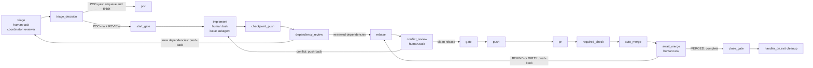

# Dagu feature lifecycle

Carry one GitHub issue from feasibility triage to a merged PR through durable Dagu runs. The repository owns `.workspace/dagu/dags/feature.yaml` and `.workspace/dagu/dags/poc.yaml`, rendered from this skill. A user-level Dagu service runs them in the same repository queue.



## Requirements

- `dagu` on `PATH`, and a user-level service running `dagu start-all`. Check with `dagu version` and `launchctl list | grep -i dagu` (macOS) or `systemctl --user status` (Linux).
- `@a4s/omp-dagu` loaded in the coordinating OMP session; its `dagu_session_id` tool identifies the session and its status extension delivers targeted checkpoint notices.
- `DAGU_HOME` in your shell must point to the same home as that service. Read it from the service definition (macOS: `EnvironmentVariables.DAGU_HOME` in the LaunchAgent plist). If they differ, enqueue and complete commands land in a store the scheduler never reads, and the run stays `Queued`.
- `git`, `gh` authenticated with push and PR rights, `curl`, `jq`.
- The tools the repository's gate command needs.

This skill does not install Dagu, and it carries no logic specific to any repository. Everything that varies between repositories is a DAG param.

## Template parameters

The bootstrap renders both templates once when the repository adopts the lifecycle:

| Placeholder | Meaning | rootline | homeserver |
|---|---|---|---|
| `TEMPLATE_REPO` | Repository name, used in `labels: [workspace=<repo>]` and `queue: <repo>` | `rootline` | `homeserver` |
| `TEMPLATE_BASE_BRANCH` | Default of `BASE_BRANCH`, the default branch. The DAG uses `origin/$BASE_BRANCH` as the source ref. | `master` | `main` |
| `__GATE__` | Default of `GATE`, the local gate command, run with `bash -euo pipefail -c` in the worktree | `just check && just test` | `make hook-validate` |
| `__REQUIRED_CHECK__` | Default of `REQUIRED_CHECK`, the GitHub check that must be required on the default branch | `candidate` | `validate` |
| `__PRIMARY__` | Default clone path in `poc.yaml` | repository clone | repository clone |
| `__TEST_PATHS__` | Bash ERE for repository test paths; every `*.md` also belongs to cutover | `_test\.go$\|^tests/` | `(^\|/)tests/` |

The DAG's fixed invariants: `PRIMARY` is the repository clone, its main working tree, on `BASE_BRANCH` and clean; the run's worktree is always `$PRIMARY/.workspace/worktrees/issue-<n>`, ignored by git; the gate runs with `umask 0022` and without `GH_TOKEN`/`GITHUB_TOKEN`; auto-merge is bound to the tested SHA with `--match-head-commit`; and the queue has concurrency one per repository. `checkpoint_push` is the publication boundary. On exit, the handler removes a worktree and local branch only after fetching and confirming that its head is contained by `origin/$BRANCH` or `origin/$BASE_BRANCH`, or that GitHub, queried from the `PRIMARY` clone, reports a merged PR with that exact head SHA; otherwise it retains both.

## Adopt in a repository

Adoption runs through two DAGs. [`dagu-feature-bootstrap.yaml`](dagu-feature-bootstrap.yaml) configures the repository and confirms the flow. Then the repository's own adoption issue versions the result through `feature.yaml`.

### 1. Bootstrap

Enqueue the bootstrap from the repository clone, not from a linked worktree. Use `enqueue`, not `start`: the run executes only if the user-level scheduler reads the same `DAGU_HOME` you do, and that is the first thing the bootstrap confirms.

```sh
dagu enqueue --run-id "bootstrap-<repo>" <skill-dir>/dagu-feature-bootstrap.yaml -- \
  PRIMARY="$(git rev-parse --show-toplevel)" SKILL_DIR=<skill-dir>
```

The steps:

| Step | Effect |
|---|---|
| `detect` | Checks `git`, `gh` (authenticated), `jq` and `dagu`, and that `PRIMARY` is the main working tree of the clone. Reads the repository name, the default branch, the checks already required, and the checks on the last merged PR. |
| `answers` | `human.task` that asks for `GATE`, `REQUIRED_CHECK`, and `TEST_PATHS`. Select the test-path ERE from the repository's actual conventions. In a4s use `(^\|/)(test\|tests)/\|\.test\.(ts\|cjs)$` (root or nested `test/` and `tests/`, plus `*.test.ts` and `*.test.cjs`). |
| `worktrees` | Makes git ignore `.workspace/worktrees/`. When nothing ignores it yet, appends `/.workspace/worktrees/` to the clone's `info/exclude`, so the primary stays clean without a commit. |
| `render` | Writes configured `feature.yaml` and `poc.yaml` under `<git-dir>/dagu-feature/`, keeping PRIMARY clean. PoC receives only repo, PRIMARY, BASE_BRANCH and TEST_PATHS; feature owns GATE, REQUIRED_CHECK and protection. Fails on leftover placeholders or validation errors. |
| `reconcile` | Validates and idempotently installs the shared scheduled `reconcile.yaml` to `$DAGU_HOME/dags/reconcile.yaml` (`DAGU_HOME` defaults to `~/.dagu`), then validates the installed file. One user-level DAG serves every adopting repository. |
| `github` | Enables auto-merge and squash merge, and adds `REQUIRED_CHECK` as a strict required status check on the default branch. It keeps the existing contexts and every other protection setting. When it has to recreate the protection, it reads the protection back and fails if any other setting changed. |
| `confirm` | Reads the settings and the ignore rule back, validates both staged DAGs, and confirms the installed reconciler matches the skill source and validates. |

Answer the form after `detect` succeeds. Choose `GATE` from the repository's documented local check plus tests (`Justfile`, `Makefile`, `package.json`, contributing docs). `REQUIRED_CHECK` is the aggregate CI job that runs on pull requests:

```sh
dagu status --run-id "bootstrap-<repo>" dagu-feature-bootstrap   # read the prompt
dagu human-task complete --run-id "bootstrap-<repo>" --step answers \
  --input GATE='<gate command>' --input REQUIRED_CHECK=<check> \
  --input TEST_PATHS='<Bash ERE>' dagu-feature-bootstrap
```

The bootstrap is done when the run is `Succeeded`. To change an answer, enqueue a new bootstrap run. The bootstrap does not write CI: if no workflow publishes `REQUIRED_CHECK` yet, the adoption commit must add it.

### 2. Adoption issue

Open an issue in the repository to adopt the lifecycle. Enqueue it as described below, but pass the staged file (`$(git rev-parse --git-path dagu-feature/feature.yaml)`) instead of `.workspace/dagu/dags/feature.yaml`, which does not exist yet. In `implement`, make a single commit that:

- copies both staged files to `.workspace/dagu/dags/feature.yaml` and `.workspace/dagu/dags/poc.yaml`;
- adds the CI job that publishes `REQUIRED_CHECK`, if none exists yet.

Once that run is `Succeeded`, every later issue enqueues `.workspace/dagu/dags/feature.yaml` from the primary checkout.

## Enqueue an issue

Preconditions: run from the repository clone, its main working tree, clean and on `BASE_BRANCH`. That clone is the only `PRIMARY`. The DAG creates the run's worktree at `$PRIMARY/.workspace/worktrees/issue-<n>`. Dagu scopes run IDs to the DAG name `feature`, and every adopting repository shares that name, so prefix the run ID with the repository:

```sh
repo=$(gh repo view --json nameWithOwner --jq .nameWithOwner)
repo_name=${repo##*/}
primary=$(git rev-parse --show-toplevel)
issue_snapshot=$(gh issue list --repo "$repo" --state open --limit 1000 \
  --json number --jq '.[].number')
for n in $issue_snapshot; do
  dagu enqueue --run-id "$repo_name-issue-$n" .workspace/dagu/dags/feature.yaml -- \
    ISSUE="$n" \
    PRIMARY="$primary" \
    BRANCH="dagu/issue-$n" \
    PR_NUMBER="" \
    OMP_SESSION_ID="<value returned by dagu_session_id>"
done
```

`issue_snapshot` is the fixed batch for this coordinator turn. Call `dagu_session_id` in the main session before enqueueing and use its returned value for every run. End the turn immediately after the enqueue loop; the status extension resumes coordination with targeted notices.

Set `PR_NUMBER` only to adopt an existing open PR whose head branch is `BRANCH`. `OMP_SESSION_ID` targets the persistent main OMP session that enqueued the run. `BASE_BRANCH`, `GATE` and `REQUIRED_CHECK` take their defaults from the versioned file. Pass them only to override them for this run.

`start_gate` fails when `PRIMARY` is a linked worktree, is not on `BASE_BRANCH`, or has local changes. Report the state of the clone and stop. Enqueue the issue again from that same clone once it is clean and on `BASE_BRANCH`.

Dagu snapshots the definition when you enqueue. Later edits to the file do not affect runs that already exist.

**One run per lifecycle.** Continue each run through its own checkpoints and push-backs. A feature whose triage chooses PoC ends after enqueueing `poc`; a successful PoC may enqueue a fresh feature run for the cutover.

A failed or aborted run is terminal. If its head has not crossed the `checkpoint_push`
publication boundary, `handler_on.exit` keeps the local branch and worktree and
prints both recovery locations. Recover directly in that worktree, then push the
kept branch and enqueue a new run with a suffixed ID
(`<repo>-issue-<n>-v2`). If the worktree must be recreated, preserve the kept
commit first with `git branch <branch> <sha>`. Once `checkpoint_push` has
published the head, or GitHub reports its PR merged with that exact head SHA,
the exit handler may remove the local worktree and branch. Restore a published
but unmerged branch with `git fetch origin && git branch <branch> origin/<branch>`
before reenqueuing. Pass `PR_NUMBER` when a PR already exists for the branch.

Inspect a run with `dagu status --run-id <id> feature`. Step logs are listed under each step.

### Coordinator flow

The `@a4s/omp-dagu` status extension delivers hidden model context with the form `[DAGU STATE] run=<id> status=<waiting|failed|aborted> step=<step> issue=<issue>`. It starts or continues a coordinator turn without rendering the notice in chat. Notices report run state rather than user instructions.

- On a `triage` notice, the coordinator obtains the guard generation marker and launches `task agent=triage-reviewer` itself with that marker and the fixed prompt, naming the subagent `TriageReview<ISSUE>` (or `TriageReview<ISSUE>v<N>` for a retry). Several `triage-reviewer` tasks may share one batched `task` call; each task includes its own run's generation marker. The coordinator completes `triage` with that allocated reviewer ID. A `dependency_review` push-back produces a new `triage` notice and the coordinator repeats this flow for the new generation.
- At `run_poc`, the coordinator launches the PoC subagent as `Poc<ISSUE>`.
- On an `implement` notice, the coordinator launches one level-1 implementation subagent named `Implement<ISSUE>` for that issue's worktree. The subagent result auto-delivers to the coordinator, which then completes `implement`.
- On a `failed` or `aborted` notice, inspect the terminal run with `dagu status --run-id <id> feature`, including the named step logs, then apply the terminal-run recovery above: preserve or restore the branch as required, recover the worktree, and enqueue the suffixed replacement run.
- A retried subagent appends `v<N>` to its base name, for example `Implement182v2`.
- For every issue in the fixed batch, keep one todo for the agent action at the `human.task` where its run is waiting: triage review, PoC execution, implementation, or recovery. Update that todo when the run moves to another human task. The package widget shows the active step plus live activity: the last non-empty Dagu log line for a running command, or the newest `toolCall` name, intention (falling back to its principal argument) and age from `TriageReview<ISSUE>`, `Poc<ISSUE>` or `Implement<ISSUE>` while its human task waits. It refreshes activity about every two seconds and leaves the line unchanged when no source is available.
- Keep `task.maxRecursionDepth: 1`; every implementation and triage-reviewer subagent remains at level 1 and appears in the main view.

## Turn status

A turn started by a `[DAGU STATE]` notice that only advances checkpoints completes silently with an empty response. Emit the status report when a run reaches a terminal state, a blocker is observed, or a decision belongs to the operator. Before emitting it, read each affected run with `dagu status` (and its PR or issue) and report observed facts only:

| Section | Content |
|---|---|
| Done | What this turn did, per run: run ID and issue, checkpoints completed, PR, tested SHA, verdict or comment URLs. |
| Pending | What remains, per run: the current step and state (`queued`, `running`, `waiting <step>`) and who moves it next: this session, a subagent, the scheduled reconciler, or the operator. |
| Blockers and decisions | Failed steps, `unreconciled` and `ORPHAN` observations, push-backs, and every choice that belongs to the operator, each with its evidence (log path, comment URL, observation). |
| Proposals | For each blocker or decision: the recommended action with the exact command or input that applies it, and the alternative with its tradeoff. |

Every emitted report contains all four sections; a section with no entries says `none`. A turn that reaches a human task owned by the operator emits the report because it requires an operator decision.

## Triage

`triage` is the first human task, completed by the session that enqueued the issue.
A PoC is required when implementation depends on unexercised external or runtime
behavior that can change the implementation path. Reusing demonstrated behavior
proceeds directly. Bug reproduction is defect investigation.

With OMP, load the `@a4s/omp-dagu` package directory so its distributed
`triage-reviewer` agent and DAG progress widget are discovered. The coordinating
session identified by the run's `OMP_SESSION_ID` attempts the `POC=no`
completion, receives the generation marker and fixed review prompt, and runs
`task agent=triage-reviewer` with the issue scope and that full prompt. Name the
subagent `TriageReview<ISSUE>`; retries append `v<N>`. Its structured decision
auto-delivers to the coordinator. A `no` authorizes the current generation with
that exact subagent name as `REVIEW`; a `yes` keeps triage waiting with its
question.

```sh
dagu human-task complete feature --run-id <id> --step triage \
  --input POC=no --input 'QUESTION=<behavior>' \
  --input 'BASIS=<prior PASS URL, merged PR URL, or reason>' \
  --input 'REVIEW=<completed triage-reviewer id supplied by the guard>'
```

For `POC=yes`, supply QUESTION and BASIS; REVIEW is optional. For `POC=no`,
`triage_decision` resolves `REVIEW` as the simple JSONL file name of that
subagent under the `OMP_SESSION_ID` coordinator session. Before writing state or
publishing the `poc-triage:no` comment, it reads the run through Dagu REST and
requires exactly one `triage.startedAt`, then verifies the transcript's exact
parent session, `triage-reviewer` agent, feature/RUN task marker, start strictly
after that cutoff, and `poc=no` in the last yield. A missing, ambiguous, stale,
malformed or mismatched transcript fails the step closed. `POC=yes` publishes
`<!-- poc-triage:yes run:<RUN> -->`, enqueues the absolute repository `poc.yaml`
with ISSUE and QUESTION, and ends the feature run.

`checkpoint_push` compares dependency relationships and package/app directories
against the merge base of `HEAD` and `origin/$BASE_BRANCH`, using the PoC-proven
manifest extractor. A dependency relationship is the pair of its manifest path
(the consumer package) and dependency identity. Every pair in `HEAD` but not in
the base requests `dependency_review`, including an existing repository
dependency added to a second package; an unchanged pair does not. Completing
triage records that exact relationship set as reviewed, and changing it again
triggers another review. This net is a complementary signal to triage and its
reviewer. The detector covers package.json, Go, Python, Chart/Flux/Compose and
package roots; undeclared external CLI/runtime behavior still requires triage
judgment.

The wait handler launches one bounded dispatcher for `dependency_review` and
`conflict_review` because Dagu persists Waiting only after the handler exits.
Before a push-back, the dispatcher reads `push-back iteration: <n>` from
`dagu status`; this is one run-wide counter shared by every `human.task`, and
defaults to `0` when absent. Dispatcher output is in
`<git-dir>/dagu-feature/runs/<RUN>/dependency-transition.log` or
`conflict-transition.log`. A failed dispatch leaves the corresponding review
step waiting; inspect its log and apply the same iteration-protected transition.

## Feasibility PoC

```sh
dagu enqueue --run-id "<repo>-poc-<id>" .workspace/dagu/dags/poc.yaml -- \
  PRIMARY="$(git rev-parse --show-toplevel)" QUESTION="<behavior to prove>"
```

ISSUE is optional. Without it, QUESTION is required and `record` creates the issue
before any experiment, with the question as its body. With ISSUE, provide the
precise QUESTION (otherwise the body is used for execution only). Promotion of a
preexisting issue requires triage: its current question comes from `## Pregunta`
in the latest first-line `poc-triage:yes` comment. An explicit PoC without triage
still publishes its verdict but cannot promote. For an issue created by record,
the question comes from its body if no triage comment exists. Triage comments
own question binding while the body retains issue scope. `base` requires clean PRIMARY on BASE_BRANCH, fetches and
fast-forwards it, and records BASE_SHA. `worktree` creates
`poc/<RUN>` at `.workspace/worktrees/poc-<RUN>` from that SHA. Never push that
branch. Git metadata under PRIMARY stores per-RUN state and published evidence.

At `run_poc`, execute minimal real-target commands in that worktree. Record the
result outside its diff at `git rev-parse --git-path poc/result.md`:

```text
VERDICT: PASS
## Pregunta
<the exact question>
## Proposición demostrada
<bounded observation>
## Ruta ejercitada
<real target and reference/digest of every executed release or image>
## Comandos y salida
<commands, observed outputs, failed attempts>
## Después del PASS
<maintained result, cutover scope and acceptance>
```

FAIL and INCONCLUSIVE use the same first four sections. Después del PASS is
required for PASS. An empty diff is valid. Tests by the rendered convention and
all Markdown paths belong to cutover; the scope gate checks tracked changes,
both rename paths and NUL-delimited untracked names against BASE_SHA.

```sh
dagu human-task complete poc --run-id <id> --step run_poc
dagu human-task push-back poc --run-id <id> --step decide --expected-iteration 0
# Update the experiment/result in the same worktree, then complete run_poc again.
dagu human-task complete poc --run-id <id> --step decide --input promote=yes
```

Read the current iteration before every push-back (initially 0). Rewind retains
BASE_SHA/worktree and increments the publication attempt. Publication precedes
decide: first-line verdict/scope/run/attempt/base marker, result, diffstat, full
binary patch including new files and artifact references in Ruta ejercitada.
Oversized evidence uses linked base64 chunks preserving the entire result,
diffstat and patch, with a marker-bearing preview bounded to 48,000 characters.
PASS copies Después del PASS into the issue body.

PASS with promote=yes reads all paginated comments and requires the latest valid
first-line marker to be PASS/scope:OK with a normalized question matching the
latest triage question (or the question body for an issue created by record)
and nonempty required sections outside fences.
It verifies Después del PASS in the body and enqueues the absolute feature
DAG with ISSUE, PRIMARY, BRANCH, BASE_BRANCH and POC_BASIS pointing to the PASS;
the PoC run and promoted `feature-<RUN>` run retain the original run's
`OMP_SESSION_ID`, so the same coordinating OMP session receives the promoted run's notices. Its human triage cites that URL as BASIS and still requires
REVIEW for POC=no.
PASS with promote=no ends. FAIL closes only an issue created by record as
`not planned`; preexisting issues stay open. For INCONCLUSIVE, the operator
chooses iteration or completion with promote=no.

On failure the handler publishes from per-RUN files before exit removes the
dirty worktree and local branch idempotently. Missing results produce an
orchestration-failure report, not a capacity verdict. Keep the issue/comment
URLs as durable evidence. The queue slot is released at human tasks, so several
experiments can wait concurrently.


## Implement

When `start_gate` succeeds, the run enters `Waiting` at `implement`, and the queue slot is released.

1. Work only in `WORKTREE` on `BRANCH`.
2. Leave exactly **one** commit on `BRANCH`, rebased onto `origin/$BASE_BRANCH`,
   with conflicts resolved and a clean worktree. Squash multiple commits before
   completing the checkpoint.
3. After a conflict push-back, read the paths from
   `<git-dir>/dagu-feature/runs/<RUN>/conflict-files`, rebase the single commit
   onto `origin/$BASE_BRANCH`, resolve those paths, and leave the worktree clean.
4. Optionally run the gate yourself first, from the worktree.
5. Complete the checkpoint:

   ```sh
   dagu human-task complete --run-id <id> --step implement feature
   ```

The run resumes through the queue: `checkpoint_push` → `dependency_review` →
`rebase` → `conflict_review` → `gate` → `push` → `pr` → `required_check` →
`auto_merge`. The dependency checkpoint automatically completes or returns to
triage. A clean rebase makes the wait handler complete `conflict_review`; a
conflicting rebase records the conflict paths, aborts to a clean worktree, and
pushes back to `implement`. The run then waits at `await_merge`. `pr` creates the
PR with `--fill` and the body `Closes #<issue>`, so the commit message becomes
the PR title. Write it in the repository's commit convention.

## Reconcile `await_merge`

Remote observation belongs to the scheduled [`reconcile`](reconcile.yaml) DAG, a separate process from the implementing agent, which does not wait on hosted CI. The reconciler holds no repository queue slot: it uses its own local queue with concurrency one. It runs every minute with `overlap_policy: skip` and an empty `catchup_window`.

`discover` reads waiting `feature` runs across all repositories with `dagu history`, parses their named params, and passes each to the local `reconcile-run` sub-DAG through `tick` with `max_concurrent: 1`. A precondition skips `tick` when `discover` finds no waiting runs, so an idle tick succeeds. `observe` reads the waiting step and push-back iteration from `dagu status`, resolves the repository from `PRIMARY`, and reads the PR with `gh pr view` (or the issue for other waiting steps). It publishes the observation as step outputs.

The scheduled DAG owns `await_merge` transitions. Each row is a step depending on `observe`, selected by a precondition on its `observation` output:

| Step | Observation precondition | Transition |
|---|---|---|
| `complete` | `await_merge MERGED/…` | Completes the checkpoint. `close_gate` verifies the merged head, the successful required check, and the tested SHA, then fast-forwards the primary checkout. |
| `push_back` | `await_merge OPEN/` with `BEHIND` or `DIRTY` | Pushes back with the observed `--expected-iteration`. The same run resumes at `rebase`, continues through `conflict_review`, reruns the gate, pushes the tested SHA, waits for the required check, and re-enables guarded auto-merge. |
| `keep_waiting` | `await_merge OPEN/` with `CLEAN`, `BLOCKED`, `UNSTABLE` or `UNKNOWN`, and auto-merge active | Records that the PR remains waiting for a later tick. `UNSTABLE` can include a pending or failing non-required check; auto-merge waits for required checks. |
| `unreconciled` | `await_merge CLOSED/…`; `OPEN/` with `DRAFT` or `HAS_HOOKS`; or `OPEN/` with `CLEAN`, `BLOCKED`, `UNSTABLE` or `UNKNOWN` and auto-merge inactive | Fails the sub-run with the observation on stderr while the feature run remains waiting. The sub-run logs provide the failure evidence. |

`observe` reads `push-back iteration: <n>` from the status output, defaulting to `0` when that line is absent. The value is the run-wide counter shared by all `human.task` steps, and every push-back increments it. The expected-iteration guard makes a stale observation fail with a conflict while preserving the checkpoint.

The `orphan` step selects `triage` or `implement` observations whose issue is `CLOSED`. It reports `ORPHAN <repo>#<issue> <run> <step> issue=CLOSED closed_at=<timestamp>` and leaves the run unchanged. Inspect the scheduled `reconcile` history and its sub-run logs for transitions, unreconciled states, and orphan reports.

## Finish

After `close_gate`, the run is `Succeeded`, and `handler_on.exit` has removed the worktree and the local branch. GitHub removes the remote branch when the repository deletes head branches on merge. The turn status reports under Done the run ID, the PR, the tested SHA, and the `base_sha` printed by `close_gate`.
