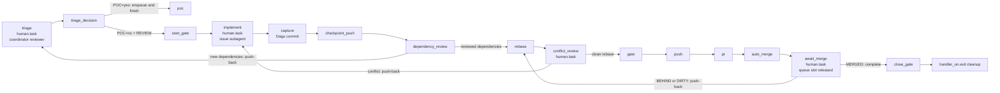

# Dagu feature lifecycle

Carry one GitHub issue from feasibility triage to a merged PR through durable Dagu runs. The repository owns `.workspace/dagu/dags/feature.yaml` and `.workspace/dagu/dags/poc.yaml`, rendered from this skill. A user-level Dagu service runs them in the same repository queue.



## Requirements

- `dagu` on `PATH`, and a user-level service running `dagu start-all`. Check with `dagu version` and `launchctl list | grep -i dagu` (macOS) or `systemctl --user status` (Linux).
- `@a4s/omp-dagu` loaded in the coordinating OMP session; its `dagu_session_id` tool identifies the session and its status extension delivers targeted checkpoint notices.
- `DAGU_HOME` in your shell must point to the same home as that service. Read it from the service definition (macOS: `EnvironmentVariables.DAGU_HOME` in the LaunchAgent plist). If they differ, enqueue and complete commands land in a store the scheduler never reads, and the run stays `Queued`.
- `git`, `gh` authenticated with push and PR rights, `curl`, `jq`.
- The tools the repository's gate command needs.

This skill does not install Dagu, and it carries no logic specific to any repository. Everything that varies between repositories is a DAG param.

## Global history retention

The versioned global configuration in [`../../dagu/base.yaml`](../../dagu/base.yaml)
sets `hist_retention_days: 7`. The operator installs it as
`$DAGU_HOME/base.yaml` (default `~/.dagu/base.yaml`). After Dagu's retention
cleanup, runs older than seven days are no longer queryable through
`dagu history` or available for `dagu retry`. Preserve evidence needed for
longer outside the run history; recovering that work requires a new run.

## Bundle identity and compatibility

Every rendered DAG starts with
`# dagu-feature-bundle: @a4s/omp-dagu@<version> source=<owner/name>@<sha40> bootstrap=<run> dagu=<version>`
and carries the label `dagu-feature-bundle=<version>`. `start_gate` and PoC
`base` print the same bundle, source and bootstrap identity into the run log.
Identify an installed bundle directly from that header and label, from repository
history, or across indexed session history:

```sh
git log --format='%h %(trailers:key=Dagu-Feature-Bundle,valueonly)' -- .workspace/dagu/dags
git log -G '^# dagu-feature-bundle:' -p -- .workspace/dagu/dags
backscroll search dagu-feature-bundle --all-projects
```

A DAG and extension are compatible when their major versions match and, while
that major is `0`, their minor versions also match. A missing label is
`unstamped`; a version outside that rule is `incompatible`. The extension warns
in its `[DAGU STATE]` notice without blocking a run.

Changing any distributed template (`feature.yaml`, `poc.yaml`, `discovery.yaml`,
`reconcile.yaml`, or `dagu-feature-bootstrap.yaml`) or this `SKILL.md` requires
a package version greater than the PR merge-base version on `origin/main` and
a matching `## <version>` section in `CHANGELOG.md`. `npm test` enforces this
for committed and local tracked changes, fetching main and ancestry when CI
has a shallow checkout. In 0.x, a minor bump marks a compatibility break.
After merge, the operator runs bootstrap to apply the new version and real
source/bootstrap identity to installed renders.

## Template parameters

The bootstrap renders the repository DAG templates when a repository adopts the lifecycle:

| Placeholder | Meaning | rootline | homeserver |
|---|---|---|---|
| `TEMPLATE_REPO` | Repository name, used in `labels: [workspace=<repo>]` and `queue: <repo>` | `rootline` | `homeserver` |
| `TEMPLATE_BASE_BRANCH` | Default of `BASE_BRANCH`, the default branch. The DAG uses `origin/$BASE_BRANCH` as the source ref. | `master` | `main` |
| `__GATE__` | Default of `GATE`, the local gate command, run with `bash -euo pipefail -c` in the worktree | `just check && just test` | `make hook-validate` |
| `__REQUIRED_CHECK__` | Default of `REQUIRED_CHECK`, the GitHub check that must be required on the default branch | `candidate` | `validate` |
| `__PRIMARY__` | Default clone path in `poc.yaml` | repository clone | repository clone |
| `__TEST_PATHS__` | Bash ERE for repository test paths; every `*.md` also belongs to cutover | `_test\.go$\|^tests/` | `(^\|/)tests/` |

The DAG's fixed invariants: `PRIMARY` is the repository clone, its main working tree, on `BASE_BRANCH` and clean; the run's worktree is always `$PRIMARY/.workspace/worktrees/issue-<n>`, ignored by git; the gate runs with `umask 0022` and without `GH_TOKEN`/`GITHUB_TOKEN`; auto-merge is bound to the tested SHA with `--match-head-commit`; and the queue has concurrency one per repository. `push` is the publication boundary after current-candidate verification. On exit, the handler removes a clean, owned worktree and local branch only after fetching and confirming that its head is contained by `origin/$BRANCH` or `origin/$BASE_BRANCH`, or that GitHub, queried from the `PRIMARY` clone, reports a merged PR with that exact head SHA. Uncaptured files and conflict resolutions remain in their worktree for recovery even when HEAD is on the base.

## Adopt in a repository

Adoption runs through two DAGs. [`dagu-feature-bootstrap.yaml`](dagu-feature-bootstrap.yaml) configures the repository and confirms the flow. Then the repository's own adoption issue versions the result through `feature.yaml`.

### 1. Bootstrap

Enqueue the bootstrap from the repository clone, not from a linked worktree. Use
`enqueue`, not `start`: the run executes only if the user-level scheduler reads
the same `DAGU_HOME` you do. Dagu run IDs reject periods, so replace the bundle
version's periods with hyphens: `bootstrap-backscroll-v0-2-0` for version
`0.2.0`.

```sh
dagu enqueue --run-id "bootstrap-<repo>-v<version-with-hyphens>" <skill-dir>/dagu-feature-bootstrap.yaml -- \
  PRIMARY="$(git rev-parse --show-toplevel)" SKILL_DIR=<skill-dir>
```

The steps:

| Step | Effect |
|---|---|
| `detect` | Checks `git`, `gh` (authenticated), `jq` and the exact required `dagu version`; reads package/version, source commit and source `origin`; fetches and requires that clean package commit on the remote default branch; reads repository settings and the installed DAG values and stamps. |
| `answers` | `human.task` that shows the current stamp, `GATE`, `REQUIRED_CHECK`, and `TEST_PATHS`, then asks for those three values. Select the test-path ERE from the repository's actual conventions. |
| `worktrees` | Makes git ignore `.workspace/worktrees/`. When nothing ignores it yet, appends `/.workspace/worktrees/` to the clone's `info/exclude`, so the primary stays clean without a commit. |
| `render` | Writes stamped and validated `feature.yaml`, `poc.yaml`, `discovery.yaml`, and `reconcile.yaml` under `<git-dir>/dagu-feature/`, keeping PRIMARY clean. Discovery receives the coordinating workspace label and derives the diagnosed repository from its `PRIMARY`. |
| `reconcile` | Idempotently installs the stamped staged `reconcile.yaml` to `$DAGU_HOME/dags/reconcile.yaml` (`DAGU_HOME` defaults to `~/.dagu`) and validates it. One user-level DAG serves every adopting repository. |
| `github` | Enables auto-merge and squash merge, and adds `REQUIRED_CHECK` as a strict required status check on the default branch. It keeps the existing contexts and every other protection setting. When it has to recreate the protection, it reads the protection back and fails if any other setting changed. |
| `confirm` | Reads settings back, validates the three staged repository DAGs, compares the installed reconciler with its stamped render, and prints the bundle identity plus the three adoption commit trailers. |

Answer the form after `detect` succeeds, reusing the current values shown in its
prompt during an upgrade. Choose `GATE` from the repository's documented local
check plus tests. `REQUIRED_CHECK` is the aggregate CI job:

```sh
dagu status --run-id "bootstrap-<repo>-v<version-with-hyphens>" dagu-feature-bootstrap
dagu human-task complete --run-id "bootstrap-<repo>-v<version-with-hyphens>" --step answers \
  --input GATE='<current gate>' --input REQUIRED_CHECK='<current check>' \
  --input TEST_PATHS='<current Bash ERE>' dagu-feature-bootstrap
```

The bootstrap is done when the run is `Succeeded`. To adopt or upgrade, open a
self-contained adoption issue and enqueue the staged `feature.yaml` for that
issue. The adoption commit copies all three staged repository DAGs and includes the exact three
trailers printed by `confirm`: `Dagu-Feature-Bundle`,
`Dagu-Feature-Source`, and `Dagu-Feature-Bootstrap`. The bootstrap does not
write CI; an initial adoption adds the workflow that publishes
`REQUIRED_CHECK` when needed.

### 2. Adoption issue

Open an issue in the repository to adopt the lifecycle. Enqueue it as described below, but pass the staged file (`$(git rev-parse --git-path dagu-feature/feature.yaml)`) instead of `.workspace/dagu/dags/feature.yaml`, which does not exist yet. In `implement`, deliver files for Dagu to capture in one commit that:

- copies the three staged files to `.workspace/dagu/dags/feature.yaml`, `.workspace/dagu/dags/poc.yaml` and `.workspace/dagu/dags/discovery.yaml`;
- adds the CI job that publishes `REQUIRED_CHECK`, if none exists yet.

Once that run is `Succeeded`, every later issue enqueues `.workspace/dagu/dags/feature.yaml` from the primary checkout.

## Descubrimiento continuo

`discovery` diagnostica cualquier repositorio adoptado desde un snapshot de su rama
por defecto y materializa unidades de trabajo aprobadas como issues. El label
`workspace=<repo>` identifica el workspace coordinador que recibe los avisos OMP;
el repositorio diagnosticado se resuelve en tiempo de ejecución desde `PRIMARY`.

```sh
dagu enqueue --run-id "discovery-<id>" .workspace/dagu/dags/discovery.yaml -- \
  LENSES="0,1,2" POLICY="defecto" SOURCE="<origen de la solicitud>" \
  LIVE_TARGET="" PRIMARY="/ruta/al/repo" \
  OMP_SESSION_ID="<valor devuelto por dagu_session_id>"
```

`snapshot` imprime `out_dir`, `sha` y `snapshot`. El out-dir es
`${DAGU_HOME:-$HOME/.dagu}/data/discovery/<owner>__<repo>/<run-id>/`; el
worktree detached que contiene queda en `snapshot/` y es de solo lectura.
Cada espera tiene un único artefacto a cargo del coordinador:

| `human.task` | Archivo que debe escribir |
|---|---|
| `discover` | Un `findings-<lente>.jsonl` por lente solicitada; ejecuta una subagente por lente, máximo 8. |
| `validate` | `verdicts.jsonl`, con un veredicto independiente por hallazgo actual. Si `LIVE_TARGET` está definido, la validación en vivo es solo lectura. |
| `consolidate` | `units.jsonl`, con cada hallazgo confirmado asignado exactamente a una unidad autocontenida y con linaje. |
| `approve` | No escribe archivo: completa el formulario `APPROVED=all` o una lista de ids de unidad separada por comas. |

Completa cada espera con `dagu human-task complete discovery --run-id <id>
--step <paso>`; para `approve`, agrega `--input APPROVED=all`. Para corregir la
consolidación, devuelve `approve` con `dagu human-task push-back discovery
--run-id <id> --step approve --expected-iteration <n>`. Los pasos deterministas
validan todos los JSONL y fallan cerrados antes de continuar.

No se escribe en GitHub antes de `approve`. `materialize` busca primero el
marcador `<!-- discovery-unit: <id> -->` entre todos los issues: crea una vez y
registra `reused: true` al repetir. `dispose` aplica `POLICY`, evita run ids de
`feature` existentes y actualiza el historial aceptado de cada lente. En la
siguiente ejecución, `temporal-<lente>.jsonl` distingue `nuevo`, `persistente`,
`resuelto` y `regresion`.

La extensión despierta la sesión `OMP_SESSION_ID` en cada espera con:

```text
[DAGU STATE] run=<id> status=waiting step=<discover|validate|consolidate|approve> dag=discovery bundle=<version|unstamped> extension=<version> compat=<ok|incompatible|unstamped>
```

## Enqueue an issue

Preconditions: run from the repository clone, its main working tree, clean and on `BASE_BRANCH`. That clone is the only `PRIMARY`. The DAG creates the run's worktree at `$PRIMARY/.workspace/worktrees/issue-<n>`. Dagu scopes run IDs to the DAG name `feature`, and every adopting repository shares that name, so prefix the run ID with the repository:

```sh
repo=$(gh repo view --json nameWithOwner --jq .nameWithOwner)
repo_name=${repo##*/}
primary=$(git rev-parse --show-toplevel)
issue_snapshot=$(gh issue list --repo "$repo" --state open --limit 1000 \
  --json number --jq '.[].number')
for n in $issue_snapshot; do
  dagu enqueue --run-id "$repo_name-issue-$n" .workspace/dagu/dags/feature.yaml -- \
    ISSUE="$n" \
    PRIMARY="$primary" \
    BRANCH="dagu/issue-$n" \
    PR_NUMBER="" \
    OMP_SESSION_ID="<value returned by dagu_session_id>"
done
```

`issue_snapshot` is the fixed batch for this coordinator turn. Call `dagu_session_id` in the main session before enqueueing and use its returned value for every run. End the turn immediately after the enqueue loop; the status extension resumes coordination with targeted notices.

Set `PR_NUMBER` only to adopt an existing open PR whose head branch is `BRANCH`. `OMP_SESSION_ID` targets the persistent main OMP session that enqueued the run. `BASE_BRANCH`, `GATE` and `REQUIRED_CHECK` take their defaults from the versioned file. Pass them only to override them for this run.

Before `start_gate` and `close_gate`, the DAG detects whether PRIMARY is clean and on
`BASE_BRANCH`. An unavailable primary pauses the same run at
`start_primary_unavailable` or `close_primary_unavailable`; PoC `base` uses
`base_primary_unavailable`. Waiting releases the repository queue slot. The detector
prints `primary dirty: <files>` or `primary on <branch>, expected <base>` to stderr;
the checkpoint prompt and the owner's `[DAGU STATE]` notice carry that cause.

The operator restores PRIMARY to clean `BASE_BRANCH`, preserving their changes.
Read the current run-wide push-back iteration (default `0` when absent), then:

```sh
dagu status --run-id <id> feature
dagu human-task push-back feature --run-id <id> \
  --step start_primary_unavailable --expected-iteration <observed-iteration>
```

Use `close_primary_unavailable` for closing, or DAG `poc` and
`base_primary_unavailable` for a PoC. Push-back rewinds to the detector; a still
unavailable primary waits again, while a clean primary skips the checkpoint and
continues in the same run. Cleaning alone leaves it Waiting. The DAG owns worktree
creation/removal and BASE_SHA capture. `await_merge` remains reconciler-owned.
PRIMARY must still be the main clone, not a linked worktree. Fetch failures and
ff-only/divergence failures remain terminal with diagnostics: the operator restores
remote access or reconciles commits preserving their work, then uses terminal-run
recovery below. The coordinator leaves commit repair to the operator.

Dagu snapshots the definition when you enqueue. Later edits to the file do not affect runs that already exist.

**One run per lifecycle.** Continue each run through its own checkpoints and push-backs. A feature whose triage chooses PoC ends after enqueueing `poc`; a successful PoC may enqueue a fresh feature run for the cutover.

A failed or aborted run is terminal. If its head has not crossed the `push`
publication boundary, `handler_on.exit` keeps the local branch and worktree and
prints both recovery locations. Recover directly in that worktree, then push the
kept branch and enqueue a new run with a suffixed ID
(`<repo>-issue-<n>-v2`). If the worktree must be recreated, preserve the kept
commit first with `git branch <branch> <sha>`. Once `push` has
published the head, or GitHub reports its PR merged with that exact head SHA,
the exit handler may remove the local worktree and branch. Restore a published
but unmerged branch with `git fetch origin && git branch <branch> origin/<branch>`
before reenqueuing. Pass `PR_NUMBER` when a PR already exists for the branch.

A failed run can leave its PR's auto-merge armed. Before reenqueuing, read
`gh pr view <pr> --json state`: `MERGED` means the issue's delivery is complete.
Otherwise the replacement run's `push` can trigger that merge; the current
candidate must complete its local gate before that publication.

Inspect a run with `dagu status --run-id <id> feature`. Step logs are listed under each step.

For a focused snapshot of active steps and run IDs by state:

```sh
dagu status --run-id <run> feature | grep -E '\[(waiting|running|failed)\]'
dagu history feature --status <waiting|running|queued> --format json --limit 50 | jq -r '.[].dagRunId'
```

Choose one of `waiting`, `running`, or `queued` for the history status placeholder.

When `feature.yaml`, `poc.yaml`, or `reconcile.yaml` changes, verify the lifecycle
change with the first applicable run enqueued after the change merges. Dagu
snapshots a DAG when it is enqueued, so a run already in progress cannot verify
the new definition. Record that run and the affected step logs in the issue.

### Coordinator flow

Each run is coordinated from an OMP session opened in its `PRIMARY` repository.
From another repository, open `omp -p --cwd <primary>` or an Orca tab in that
primary before enqueueing and coordinating its run. The `POC=no` guard compares
canonical main-worktree identities and the session's actual transcript directory
with `triage_decision`'s encoded `PRIMARY` namespace. A linked-worktree session
matches only when its transcript directory belongs to that primary namespace.
On mismatch the guard names the expected primary and keeps triage waiting.

The coordinator only drives Dagu checkpoints; subagents perform triage review,
PoCs and implementation, rather than the coordinator implementing inline.
Coordinate only runs owned by this session. Before taking an issue that another
live repository session could own, contact that session with `orca terminal send`
and establish ownership. For waiting `poc-*` runs, inspect the issue state and
published verdict before proposing closure; those runs may belong to another session.

Worktrees belong to Dagu: `start_gate` creates or adopts
`.workspace/worktrees/issue-<n>` and `dagu/issue-<n>`, and
`close_gate`/`handler_on.exit` own their removal under the recovery contract above.
The coordinator never creates them with `git worktree add` or `git branch`,
including to get ahead while a run is blocked. Implementers start only when
`implement` is waiting. If another session dirties PRIMARY, notify that session
and wait for its clean confirmation, then resume the existing availability
checkpoint; reenqueue only a terminal run under the recovery contract above.
Keep recovery inside Dagu's lifecycle.

Issue every `dagu human-task complete` in its own `bash` call: the triage guard
blocks the entire command containing the completion.

The `@a4s/omp-dagu` status extension delivers hidden model context for every waiting human task in `feature`, `poc` and `discovery`, and for final `succeeded`. Waiting notices have the form `[DAGU STATE] run=<id> status=waiting step=<step> <issue=<issue>|dag=<dag>> bundle=<version|unstamped> extension=<version> compat=<ok|incompatible|unstamped> iteration=<approvalIteration>`. Success uses `status=succeeded` with run identity and bundle fields; feature/discovery failures and aborts include their terminal step. The persisted Dagu event log recovers openings missed by SSE; deduplication uses DAG, run, step and approval iteration (omitted means zero), or run/status for success. An owner-session FIFO starts one autonomous turn at a time while idle and delivers asides during an active turn. The initial sweep is a silent baseline. Notices start or continue coordinator turns without rendering in chat and report run state rather than user instructions.

- On a `triage` notice, the coordinator obtains the guard generation marker and launches `task agent=triage-reviewer` itself with that marker and the fixed prompt, naming the subagent `TriageReview<ISSUE>` (or `TriageReview<ISSUE>v<N>` for a retry). Several `triage-reviewer` tasks may share one batched `task` call; each task includes its own run's generation marker. The coordinator completes `triage` with that allocated reviewer ID. A `dependency_review` push-back produces a new `triage` notice and the coordinator repeats this flow for the new generation.
- At `run_poc`, the coordinator launches the PoC subagent as `Poc<ISSUE>`.
- On an `implement` notice, the coordinator launches one level-1 implementation subagent named `Implement<ISSUE>` for that issue's worktree, with the contract in **Implement**. The result auto-delivers to the coordinator, which reviews the diff before completing `implement`.
- On a `failed` or `aborted` notice, inspect the terminal run with `dagu status --run-id <id> feature`, including the named step logs, then apply the terminal-run recovery above: preserve or restore the branch as required, recover the worktree, and enqueue the suffixed replacement run.
- A retried subagent appends `v<N>` to its base name, for example `Implement182v2`.
- For every issue in the fixed batch, keep one todo for the agent action at the `human.task` where its run is waiting: triage review, PoC execution, implementation, or recovery. Update that todo when the run moves to another human task. The package widget shows the active step plus live activity: the last non-empty Dagu log line for a running command, or `<tool> <intention> (<age>s)` from the newest `toolCall` in `TriageReview<ISSUE>`, `Poc<ISSUE>` or `Implement<ISSUE>` while its human task waits. Intention comes from `i`, then `title`, then the principal argument; the task name is omitted. It refreshes activity about every two seconds and leaves the line unchanged when no source is available. The `Workflows` HUD folds to three completion-ordered tree rows and expands to eight; `/workflows` toggles, `expand` and `collapse` set the fold, and `hide` and `show` control visibility across session switches.
- Keep `task.maxRecursionDepth: 1`; every implementation and triage-reviewer subagent remains at level 1 and appears in the main view.
- A notice whose `compat` is not `ok` goes under **Blockers and decisions**. Put the exact `dagu enqueue --run-id "bootstrap-<repo>-v<version-with-hyphens>" ...` upgrade command under **Proposals**. When the request authorizes upgrades, the coordinator runs that upgrade procedure, completes `answers` with the current values shown by the prompt, opens the adoption issue, and enqueues its staged `feature.yaml`.

## Turn status

A turn started by a `[DAGU STATE]` notice that only advances checkpoints completes silently with an empty response. Emit the status report in the operator's language when a run reaches a terminal state, a blocker is observed, or a decision belongs to the operator. Before emitting it, read each affected run with `dagu status` (and its PR or issue) and report observed facts only:

| Section | Content |
|---|---|
| Done | What this turn did, per run: run ID and issue, checkpoints completed, PR, tested SHA, verdict or comment URLs. |
| Pending | What remains, per run: the current step and state (`queued`, `running`, `waiting <step>`) and who moves it next: this session, a subagent, the scheduled reconciler, or the operator. |
| Blockers and decisions | Failed steps, `unreconciled` and `ORPHAN` observations, push-backs, and every choice that belongs to the operator, each with its evidence (log path, comment URL, observation). |
| Proposals | For each blocker or decision: the recommended action with the exact command or input that applies it, and the alternative with its tradeoff. |

Every emitted report contains all four sections; a section with no entries says `none`. A turn that reaches a human task owned by the operator emits the report because it requires an operator decision.

## Triage

`triage` is the first human task, completed by the session that enqueued the issue.
A PoC is required when implementation depends on unexercised external or runtime
behavior that can change the implementation path. Reusing demonstrated behavior
proceeds directly. Bug reproduction is defect investigation.

With OMP, load the `@a4s/omp-dagu` package directory so its distributed
`triage-reviewer` agent and DAG progress widget are discovered. The coordinating
session identified by the run's `OMP_SESSION_ID` attempts the `POC=no`
completion, receives the generation marker and fixed review prompt, and runs
`task agent=triage-reviewer` with the issue scope and that full prompt. Name the
subagent `TriageReview<ISSUE>`; retries append `v<N>`. Its structured decision
auto-delivers to the coordinator. A `no` authorizes the current generation with
the allocated reviewer ID supplied by the guard as `REVIEW`; a `yes` keeps triage
waiting with its question. Another rejected `POC=no` completion emits a fresh
request marker in that same generation. Include that marker and the fixed prompt
when launching the next reviewer with corrected scope or new evidence. The
latest valid bound review decides, and its exact allocated ID is the `REVIEW`
submitted to `triage_decision`; earlier reviewer IDs remain rejected.

```sh
dagu human-task complete feature --run-id <id> --step triage \
  --input POC=no --input 'QUESTION=<behavior>' \
  --input 'BASIS=<prior PASS URL, merged PR URL, or reason>' \
  --input 'REVIEW=<completed triage-reviewer id supplied by the guard>'
```

For `POC=yes`, supply QUESTION and BASIS; REVIEW is optional. For `POC=no`,
`triage_decision` resolves `REVIEW` as the simple JSONL file name of that
subagent under the `OMP_SESSION_ID` coordinator session. Before writing state or
publishing the `poc-triage:no` comment, it reads the run through Dagu REST and
requires exactly one `triage.startedAt`, then verifies the transcript's exact
parent session, `triage-reviewer` agent, feature/RUN task marker, start strictly
after that cutoff, and `poc=no` in the last yield. A missing, ambiguous, stale,
malformed or mismatched transcript fails the step closed. `POC=yes` publishes
`<!-- poc-triage:yes run:<RUN> -->`, enqueues the absolute repository `poc.yaml`
with ISSUE and QUESTION, and ends the feature run.

`checkpoint_push` compares dependency relationships and package/app directories
against the recorded candidate base, using the PoC-proven
manifest extractor. A dependency relationship is the pair of its manifest path
(the consumer package) and dependency identity. Every pair in the candidate but not in
the base requests `dependency_review`, including an existing repository
dependency added to a second package; an unchanged pair does not. Completing
triage records that exact relationship set as reviewed, and changing it again
triggers another review. This net is a complementary signal to triage and its
reviewer. The detector covers package.json, Go, Python, Chart/Flux/Compose and
package roots; undeclared external CLI/runtime behavior still requires triage
judgment.

The wait handler launches one bounded dispatcher for `dependency_review` and
`conflict_review` because Dagu persists Waiting only after the handler exits.
Before a push-back, the dispatcher reads `push-back iteration: <n>` from
`dagu status`; this is one run-wide counter shared by every `human.task`, and
defaults to `0` when absent. Dispatcher output is in
`<git-dir>/dagu-feature/runs/<RUN>/dependency-transition.log` or
`conflict-transition.log`. A failed dispatch leaves the corresponding review
step waiting; inspect its log and apply the same iteration-protected transition.

## Feasibility PoC

```sh
dagu enqueue --run-id "<repo>-poc-<id>" .workspace/dagu/dags/poc.yaml -- \
  PRIMARY="$(git rev-parse --show-toplevel)" QUESTION="<behavior to prove>"
```

ISSUE is optional. Without it, QUESTION is required and `record` creates the issue
before any experiment, with the question as its body. With ISSUE, provide the
precise QUESTION (otherwise the body is used for execution only). Promotion of a
preexisting issue requires triage: its current question comes from `## Pregunta`
in the latest first-line `poc-triage:yes` comment. An explicit PoC without triage
still publishes its verdict but cannot promote. For an issue created by record,
the question comes from its body if no triage comment exists. Triage comments
own question binding while the body retains issue scope. `base` requires clean PRIMARY on BASE_BRANCH, fetches and
fast-forwards it, and records BASE_SHA. `worktree` creates
`poc/<RUN>` at `.workspace/worktrees/poc-<RUN>` from that SHA. Never push that
branch. Git metadata under PRIMARY stores per-RUN state and published evidence.

At `run_poc`, execute minimal real-target commands in that worktree. Record the
result outside its diff at `git rev-parse --git-path poc/result.md`:

```text
VERDICT: PASS
## Pregunta
<the exact question>
## Proposición demostrada
<bounded observation>
## Ruta ejercitada
<real target and reference/digest of every executed release or image>
## Comandos y salida
<commands, observed outputs, failed attempts>
## Después del PASS
<maintained result, cutover scope and acceptance>
```

FAIL and INCONCLUSIVE use the same first four sections. Después del PASS is
required for PASS. An empty diff is valid. Tests by the rendered convention and
all Markdown paths belong to cutover; the scope gate checks tracked changes,
both rename paths and NUL-delimited untracked names against BASE_SHA.

```sh
dagu human-task complete poc --run-id <id> --step run_poc
dagu human-task push-back poc --run-id <id> --step decide --expected-iteration 0
# Update the experiment/result in the same worktree, then complete run_poc again.
dagu human-task complete poc --run-id <id> --step decide --input promote=yes
```

Read the current iteration before every push-back (initially 0). Rewind retains
BASE_SHA/worktree and increments the publication attempt. Publication precedes
decide: first-line verdict/scope/run/attempt/base marker, result, diffstat, full
binary patch including new files and artifact references in Ruta ejercitada.
Oversized evidence uses linked base64 chunks preserving the entire result,
diffstat and patch, with a marker-bearing preview bounded to 48,000 characters.
PASS copies Después del PASS into the issue body.

PASS with promote=yes reads all paginated comments and requires the latest valid
first-line marker to be PASS/scope:OK with a normalized question matching the
latest triage question (or the question body for an issue created by record)
and nonempty required sections outside fences.
It verifies Después del PASS in the body and enqueues the absolute feature
DAG with ISSUE, PRIMARY, BRANCH, BASE_BRANCH and POC_BASIS pointing to the PASS;
the PoC run and promoted `feature-<RUN>` run retain the original run's
`OMP_SESSION_ID`, so the same coordinating OMP session receives the promoted run's notices. Its human triage cites that URL as BASIS and still requires
REVIEW for POC=no.
PASS with promote=no ends. FAIL closes only an issue created by record as
`not planned`; preexisting issues stay open. For INCONCLUSIVE, the operator
chooses iteration or completion with promote=no.

On failure the handler publishes from per-RUN files before exit removes the
dirty worktree and local branch idempotently. Missing results produce an
orchestration-failure report, not a capacity verdict. Keep the issue/comment
URLs as durable evidence. The queue slot is released at human tasks, so several
experiments can wait concurrently.


## Implement

When `start_gate` succeeds, the run enters `Waiting` at `implement`, and the queue slot is released.

Give `Implement<ISSUE>` the exact `WORKTREE` path and `BRANCH`, plus this contract:

- Leave real-`DAGU_HOME` `dagu human-task` transitions, pushes, PR creation and
  GitHub comments to the coordinator and DAG. Leave `omp plugin link` and
  `~/.omp` configuration to the operator.
- Own verification and the gate, following the steps below.
- Run live Dagu tests with an isolated `DAGU_HOME` created by `mktemp -d`.
- When siblings edit distinct parts of shared files, touch only the assigned
  part and add test cases rather than rewriting shared fixtures.

1. Work only in `WORKTREE` on `BRANCH`; never touch the primary checkout.
2. Deliver modified, added, deleted, renamed and binary files inside the assigned
   worktree, with a summary and a conventional commit message. Dagu's `capture`
   validates canonical PRIMARY/worktree, branch and run/session ownership, stages
   the delivery and generates the single candidate commit over the recorded base.
3. After a conflict push-back, resolve the files listed in
   `<git-dir>/dagu-feature/runs/<RUN>/conflict-files` in place. Dagu keeps the same
   run and branch, prepares the updated base and leaves conflict markers for the
   implementer; the next capture commits the resolved files.
4. Optionally run the gate yourself first, from the worktree.
5. Complete the checkpoint:

   ```sh
   dagu human-task complete --run-id <id> --step implement \
     --input SUMMARY='<change summary>' --input MESSAGE='<conventional message>' feature
   ```

The run resumes through the queue: `capture` → `checkpoint_push` →
`dependency_review` → `rebase` → `conflict_review` → `gate` → `push` → `pr` → `auto_merge`. The
dependency checkpoint automatically completes or returns to triage. A clean
rebase makes the wait handler complete `conflict_review`; a conflicting rebase
records the conflict paths, preserves the delivery with conflict markers, and
pushes back to `implement`. After `auto_merge` requests guarded auto-merge for the tested SHA,
the run waits at `await_merge` and releases the repository queue slot. GitHub
merges only after the required check succeeds. `pr` creates the PR with `--fill`
and the body `Closes #<issue>`, so the commit message becomes the PR title.
Write it in the repository's commit convention.

The `gate` step changes to the worktree and executes the complete `GATE`
command from scratch. If that attempt fails, Dagu retries it once after five
seconds. The retry therefore repeats setup such as `npm ci`; only after a
successful gate does the step check that the worktree is clean and record the
tested SHA.

Per-run state under `<git-dir>/dagu-feature/runs/<RUN>` records `identity`,
`base`, `diff.patch` (full binary patch), `candidate.json` (SHA, tree, message,
summary and capture iteration), and `gate.json` (tested SHA and exact GATE).
Identical captures reuse the SHA and commit count; author/committer dates are
fixed from the run ID and capture iteration. Corrections create a new single
commit over the base. Corrections and rebases archive earlier candidate/diff/gate
records under `historical/<SHA>/`; all declared local checks belong in GATE and
run again for the current SHA. `push` and `auto_merge` require current evidence
and a clean worktree. `checkpoint_push` performs the dependency comparison
locally; `push` is the publication boundary after the gate.

This division of responsibility is **advisory while the TUI has direct access
to Git and the Dagu store**. The contract and workflow checks establish the
candidate identity; they are not a sandbox against a process that can rewrite
the repository or its run state.

## Reconcile `await_merge`

Remote observation belongs to the scheduled [`reconcile`](reconcile.yaml) DAG, a separate process from the implementing agent, which does not wait on hosted CI. The reconciler holds no repository queue slot: it uses its own local queue with concurrency one. It runs every minute with `overlap_policy: skip` and an empty `catchup_window`.

`discover` reads waiting `feature` runs across all repositories with `dagu history` and parses their named params. On every tick, `leftovers` also reads the complete `feature` and `poc` histories, collects each distinct `PRIMARY`, and compares its managed worktrees and local `dagu/*` branches with runs in `queued`, `running` or `waiting`. This check runs even when no feature run is waiting.

Historical `PRIMARY` paths that are missing as directories are skipped with `SKIP_PRIMARY <path> missing`. Existing directories are inspected normally; a Git failure remains visible and fails `leftovers`.

An unowned resource fails the tick with `LEFTOVER <repo> worktree=<path|none> branch=<branch|none> last_run=<id|none> last_status=<status|none>`. The reconciler only reports it; the operator decides whether to recover or remove it. A managed feature resource is owned by the matching `BRANCH` or `issue-<ISSUE>` worktree, and a PoC resource by its `poc/<run>` branch or `poc-<run>` worktree. Other local branches are outside this check.

PoC history rows remain associated with their `dagRunId` even when optional `BRANCH` or `ISSUE` params are missing. Active PoC runs own their canonical worktree and branch; terminal runs are reported with that run ID and status.

`tick` and `leftovers` both depend on `discover`, so waiting feature runs are reconciled independently of leftover detection. A leftover or detection error still makes the overall DAG `Failed`, including when no feature runs are waiting. `discover` passes each waiting feature run to the local `reconcile-run` sub-DAG through `tick` with `max_concurrent: 1`. A precondition skips only this fan-out when `discover` found no waiting runs. `observe` reads the waiting step and push-back iteration from `dagu status`, resolves the repository from `PRIMARY`, and reads the PR with `gh pr view` (or the issue for other waiting steps). It publishes the observation as step outputs.

The scheduled DAG owns `await_merge` transitions. Each row is a step depending on `observe`, selected by a precondition on its `observation` output:

| Step | Observation precondition | Transition |
|---|---|---|
| `complete` | `await_merge MERGED/…` | Completes the checkpoint. `close_gate` verifies the merged head, successful required check and tested SHA, fast-forwards the clean primary checkout to `origin/$BASE_BRANCH`, removes and verifies the run worktree, and removes and verifies both local and remote run branches. |
| `push_back` | `await_merge OPEN/` with `BEHIND` or `DIRTY` | Pushes back with the observed `--expected-iteration`. A PR born `DIRTY` reaches `await_merge`; the same run resumes at `rebase`, continues through `conflict_review`, reruns the gate, pushes the tested SHA, and requests guarded auto-merge again. |
| `keep_waiting` | `await_merge OPEN/` with `CLEAN`, `BLOCKED`, `UNSTABLE` or `UNKNOWN`, and auto-merge active | Records that the PR remains waiting for a later tick while GitHub waits for the required check to succeed. `UNSTABLE` can include a pending or failing non-required check. |
| `unreconciled` | `await_merge CLOSED/…`; `OPEN/` with `DRAFT` or `HAS_HOOKS`; or `OPEN/` with `CLEAN`, `BLOCKED`, `UNSTABLE` or `UNKNOWN` and auto-merge inactive | Fails the sub-run with the observation on stderr while the feature run remains waiting. The sub-run logs provide the failure evidence. |

`observe` reads `push-back iteration: <n>` from the status output, defaulting to `0` when that line is absent. The value is the run-wide counter shared by all `human.task` steps, and every push-back increments it. The expected-iteration guard makes a stale observation fail with a conflict while preserving the checkpoint.

The `orphan` step selects `triage` or `implement` observations whose issue is `CLOSED`. It reports `ORPHAN <repo>#<issue> <run> <step> issue=CLOSED closed_at=<timestamp>` and leaves the run unchanged. Inspect the scheduled `reconcile` history and its sub-run logs for transitions, unreconciled states, and orphan reports.

## Finish

After `close_gate`, the run is `Succeeded`. The closing contract is a merged PR, a clean primary checkout exactly at `origin/$BASE_BRANCH`, no run worktree, and no local or remote run branch; `close_gate` performs and verifies every part of that contract and prints the cleanup result. `handler_on.exit` covers terminal runs that did not complete `close_gate`, retaining unpublished work and removing published work according to its recovery rules. The turn status reports under Done the run ID, the PR, the tested SHA, and the `base_sha` printed by `close_gate`.
