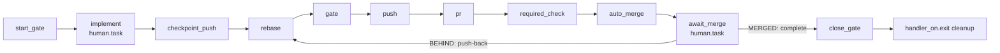

# Dagu feature lifecycle

Carry one GitHub issue from a clean default branch to a merged PR through one durable Dagu run. The repository owns the workflow in `.workspace/dagu/dags/feature.yaml`, built from [`feature.yaml`](feature.yaml) in this skill. A user-level Dagu service runs it.



## Requirements

- `dagu` on `PATH`, and a user-level service running `dagu start-all`. Check with `dagu version` and `launchctl list | grep -i dagu` (macOS) or `systemctl --user status` (Linux).
- `DAGU_HOME` in your shell must point to the same home as that service. Read it from the service definition (macOS: `EnvironmentVariables.DAGU_HOME` in the LaunchAgent plist). If they differ, enqueue and complete commands land in a store the scheduler never reads, and the run stays `Queued`.
- `git`, `gh` authenticated with push and PR rights, `jq`.
- The tools the repository's gate command needs.

This skill does not install Dagu, and it carries no logic specific to any repository. Everything that varies between repositories is a DAG param.

## Template parameters

Every `__NAME__` placeholder in `feature.yaml` is replaced once at adoption:

| Placeholder | Meaning | rootline | homeserver |
|---|---|---|---|
| `__REPO__` | Repository name, used in `labels: [workspace=<repo>]` and `queue: <repo>` | `rootline` | `homeserver` |
| `__BASE_BRANCH__` | Default of `BASE_BRANCH`, the default branch. The DAG uses `origin/$BASE_BRANCH` as the source ref. | `master` | `main` |
| `__GATE__` | Default of `GATE`, the local gate command, run with `bash -euo pipefail -c` in the worktree | `just check && just test` | `make hook-validate` |
| `__REQUIRED_CHECK__` | Default of `REQUIRED_CHECK`, the GitHub check that must be required on the default branch | `candidate` | `validate` |

The DAG's fixed invariants: the gate runs with `umask 0022` and without `GH_TOKEN`/`GITHUB_TOKEN`; auto-merge is bound to the tested SHA with `--match-head-commit`; the queue has concurrency one per repository; `handler_on.exit` removes the run's worktree and local branch whether the run succeeds, fails, or is aborted.

## Adopt in a repository

1. Read the real values from the repository:
   - default branch: `gh repo view --json defaultBranchRef --jq .defaultBranchRef.name`;
   - gate: the command that the repository's contributing docs, `Justfile`, or `Makefile` define as the local check plus tests;
   - required check: the aggregate job that CI publishes on pull requests (`gh pr checks <recent-pr> --json name`).
2. Configure a copy outside the checkout, so that the primary checkout stays clean:

   ```sh
   repo=<repo>
   stage="${TMPDIR:-/tmp}/dagu-feature-$repo"
   mkdir -p "$stage"
   sed -e "s|__REPO__|$repo|g" \
       -e "s|__BASE_BRANCH__|<base-branch>|" \
       -e "s|__GATE__|<gate command>|" \
       -e "s|__REQUIRED_CHECK__|<required-check>|" \
       <skill-dir>/feature.yaml > "$stage/feature.yaml"
   grep -n '__[A-Z_]*__' "$stage/feature.yaml"   # must print nothing
   dagu validate "$stage/feature.yaml"
   ```

   Escape `&` as `\&` and `|` as `\|` inside the `sed` replacement.
3. Make `REQUIRED_CHECK` a strict required status check on the default branch. Merge `strict` and the context into the existing required checks, never replace them:

   ```sh
   gh api "repos/{owner}/{repo}/branches/<base-branch>/protection" --jq '.required_status_checks'
   ```

   - **Status checks already required:** `PATCH` them, listing every existing context plus the new one, because `contexts` replaces the list:

     ```sh
     gh api -X PATCH "repos/{owner}/{repo}/branches/<base-branch>/protection/required_status_checks" \
       -F strict=true -f 'contexts[]=<existing-check>' -f 'contexts[]=<required-check>'
     ```

   - **No required status checks** (`null` or a 404): `PUT` the protection. When protection already exists, carry over its current `enforce_admins`, `required_pull_request_reviews`, `restrictions` and flags from the `GET` instead of the `null`s below:

     ```sh
     gh api -X PUT "repos/{owner}/{repo}/branches/<base-branch>/protection" --input - <<'EOF'
     {"required_status_checks":{"strict":true,"contexts":["<required-check>"]},
      "enforce_admins":null,"required_pull_request_reviews":null,"restrictions":null}
     EOF
     ```

   The repository must also allow auto-merge and squash merge (`gh api repos/{owner}/{repo} --jq '{allow_auto_merge,allow_squash_merge}'`). Without a required check, `auto_merge` has nothing to wait for and GitHub rejects the request.
4. Version the file through the lifecycle itself. Open an adoption issue and enqueue that issue with the staged copy (see below). In `implement`, copy `$stage/feature.yaml` to `.workspace/dagu/dags/feature.yaml` in the worktree, run `dagu validate` on it, and commit it. From then on, every run uses `.workspace/dagu/dags/feature.yaml` from the primary checkout.

## Enqueue an issue

Preconditions: the primary checkout is clean and on `BASE_BRANCH`. Choose a worktree path outside the primary checkout and one branch. Dagu scopes run IDs to the DAG name `feature`, and every adopting repository shares that name, so prefix the run ID with the repository:

```sh
repo=<repo>; n=<issue>
dagu enqueue --run-id "$repo-issue-$n" .workspace/dagu/dags/feature.yaml -- \
  ISSUE="$n" \
  PRIMARY="$PWD" \
  WORKTREE="$HOME/.local/share/$repo/worktrees/issue-$n" \
  BRANCH="dagu/issue-$n" \
  PR_NUMBER=""
```

`PRIMARY` must be the absolute top-level path printed by `git rev-parse --show-toplevel`. Set `PR_NUMBER` only to adopt an existing open PR whose head branch is `BRANCH`. `BASE_BRANCH`, `GATE` and `REQUIRED_CHECK` take their defaults from the versioned file. Pass them only to override them for this run.

Dagu snapshots the definition when you enqueue. Later edits to the file do not affect runs that already exist.

**One run per issue.** Continue the same run through its checkpoints: `implement`, `await_merge`, and push-back. Do not enqueue a replacement run for a later phase.

A failed or aborted run is terminal. `handler_on.exit` has already removed its worktree and its local branch. Once `checkpoint_push` has succeeded, the commit survives on `origin/<branch>`. To recover:

1. Fix the cause.
2. Restore the local branch: `git fetch origin && git branch <branch> origin/<branch>`. `start_gate` adopts an existing local branch instead of creating a new one from `origin/$BASE_BRANCH`.
3. Enqueue a new run with a suffixed ID (`<repo>-issue-<n>-v2`). Pass `PR_NUMBER` when a PR is already open for the branch.

Inspect a run with `dagu status --run-id <id> feature`. Step logs are listed under each step.

## Implement

When `start_gate` succeeds, the run enters `Waiting` at `implement`, and the queue slot is released.

1. Work only in `WORKTREE` on `BRANCH`.
2. Leave exactly **one** commit on top of `origin/$BASE_BRANCH`, and a clean worktree. `rebase` fails when the branch has any other number of commits. Squash before completing if you made several.
3. Optionally run the gate yourself first, from the worktree.
4. Complete the checkpoint:

   ```sh
   dagu human-task complete --run-id <id> --step implement feature
   ```

The run resumes through the queue: `checkpoint_push` → `rebase` → `gate` → `push` → `pr` → `required_check` → `auto_merge`. It then waits at `await_merge`. `pr` creates the PR with `--fill` and the body `Closes #<issue>`, so the commit message becomes the PR title. Write it in the repository's commit convention.

## Reconcile `await_merge`

Remote observation belongs to a separate worker or process, not to the implementing agent, which does not wait on hosted CI. The reconciler holds no queue slot. It observes:

```sh
gh pr view <branch> --json number,state,mergeStateStatus,headRefOid,autoMergeRequest
```

Apply exactly one transition per observation:

| Observation | Transition |
|---|---|
| `state=MERGED` | `dagu human-task complete --run-id <id> --step await_merge feature`. `close_gate` then verifies the merged head, the successful required check, and the tested SHA, and fast-forwards the primary checkout. |
| `state=OPEN`, `mergeStateStatus=BEHIND` | Read the current iteration and push back: `dagu human-task push-back --run-id <id> --step await_merge --expected-iteration <n> feature`. The same run resumes at `rebase`, reruns the gate, pushes the new tested SHA, waits for the required check, and re-enables guarded auto-merge. |
| `state=OPEN`, `mergeStateStatus` `CLEAN`, `BLOCKED` or `UNKNOWN`, with `autoMergeRequest` non-null | Keep waiting and observe again later. |

Read `<n>` from `dagu status --run-id <id> feature`. The `await_merge` entry prints `push-back iteration: <n>` after the first push-back, and the iteration is `0` while that line is absent. Every push-back increments it. Read it again before the next push-back. A mismatch fails with a conflict and changes nothing, so two reconcilers cannot rewind the same checkpoint twice.

Any other observation is a failed reconciliation: a head SHA different from the `auto_merge` output, `DIRTY` (conflict), a failed required check, auto-merge disabled on an open PR, or `CLOSED` without merge. Leave the run waiting, record the observation and the step logs as evidence, and report it. Do not complete the checkpoint.

## Finish

After `close_gate`, the run is `Succeeded`, and `handler_on.exit` has removed the worktree and the local branch. GitHub removes the remote branch when the repository deletes head branches on merge. Report the run ID, the PR, the tested SHA, and the `base_sha` printed by `close_gate`.
