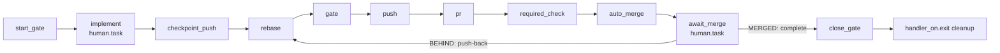

# Dagu feature lifecycle

Carry one GitHub issue from a clean default branch to a merged PR through one durable Dagu run. The repository owns the workflow in `.workspace/dagu/dags/feature.yaml`, built from [`feature.yaml`](feature.yaml) in this skill. A user-level Dagu service runs it.



## Requirements

- `dagu` on `PATH`, and a user-level service running `dagu start-all`. Check with `dagu version` and `launchctl list | grep -i dagu` (macOS) or `systemctl --user status` (Linux).
- `DAGU_HOME` in your shell must point to the same home as that service. Read it from the service definition (macOS: `EnvironmentVariables.DAGU_HOME` in the LaunchAgent plist). If they differ, enqueue and complete commands land in a store the scheduler never reads, and the run stays `Queued`.
- `git`, `gh` authenticated with push and PR rights, `jq`.
- The tools the repository's gate command needs.

This skill does not install Dagu, and it carries no logic specific to any repository. Everything that varies between repositories is a DAG param.

## Template parameters

The bootstrap replaces every `__NAME__` placeholder in `feature.yaml` once, when the repository adopts the lifecycle:

| Placeholder | Meaning | rootline | homeserver |
|---|---|---|---|
| `__REPO__` | Repository name, used in `labels: [workspace=<repo>]` and `queue: <repo>` | `rootline` | `homeserver` |
| `__BASE_BRANCH__` | Default of `BASE_BRANCH`, the default branch. The DAG uses `origin/$BASE_BRANCH` as the source ref. | `master` | `main` |
| `__GATE__` | Default of `GATE`, the local gate command, run with `bash -euo pipefail -c` in the worktree | `just check && just test` | `make hook-validate` |
| `__REQUIRED_CHECK__` | Default of `REQUIRED_CHECK`, the GitHub check that must be required on the default branch | `candidate` | `validate` |

The DAG's fixed invariants: `PRIMARY` is the repository clone, its main working tree, on `BASE_BRANCH` and clean; the run's worktree is always `$PRIMARY/.workspace/worktrees/issue-<n>`, ignored by git; the gate runs with `umask 0022` and without `GH_TOKEN`/`GITHUB_TOKEN`; auto-merge is bound to the tested SHA with `--match-head-commit`; the queue has concurrency one per repository; `handler_on.exit` removes the run's worktree and local branch whether the run succeeds, fails, or is aborted.

## Adopt in a repository

Adoption runs through two DAGs. [`dagu-feature-bootstrap.yaml`](dagu-feature-bootstrap.yaml) configures the repository and confirms the flow. Then the repository's own adoption issue versions the result through `feature.yaml`.

### 1. Bootstrap

Enqueue the bootstrap from the repository clone, not from a linked worktree. Use `enqueue`, not `start`: the run executes only if the user-level scheduler reads the same `DAGU_HOME` you do, and that is the first thing the bootstrap confirms.

```sh
dagu enqueue --run-id "bootstrap-<repo>" <skill-dir>/dagu-feature-bootstrap.yaml -- \
  PRIMARY="$(git rev-parse --show-toplevel)" SKILL_DIR=<skill-dir>
```

The steps:

| Step | Effect |
|---|---|
| `detect` | Checks `git`, `gh` (authenticated), `jq` and `dagu`, and that `PRIMARY` is the main working tree of the clone. Reads the repository name, the default branch, the checks already required, and the checks on the last merged PR. |
| `answers` | `human.task` that asks for `GATE` and `REQUIRED_CHECK`. The prompt shows the detected values. |
| `worktrees` | Makes git ignore `.workspace/worktrees/`. When nothing ignores it yet, appends `/.workspace/worktrees/` to the clone's `info/exclude`, so the primary stays clean without a commit. |
| `render` | Writes the configured template to `<git-dir>/dagu-feature/feature.yaml` inside the clone's git directory, so the primary stays clean. Every value is JSON-quoted, and the step fails on any leftover placeholder or a `dagu validate` error. |
| `github` | Enables auto-merge and squash merge, and adds `REQUIRED_CHECK` as a strict required status check on the default branch. It keeps the existing contexts and every other protection setting. When it has to recreate the protection, it reads the protection back and fails if any other setting changed. |
| `confirm` | Reads the settings and the ignore rule back and validates the staged file again. |

Answer the form after `detect` succeeds. Choose `GATE` from the repository's documented local check plus tests (`Justfile`, `Makefile`, `package.json`, contributing docs). `REQUIRED_CHECK` is the aggregate CI job that runs on pull requests:

```sh
dagu status --run-id "bootstrap-<repo>" dagu-feature-bootstrap   # read the prompt
dagu human-task complete --run-id "bootstrap-<repo>" --step answers \
  --input GATE='<gate command>' --input REQUIRED_CHECK=<check> dagu-feature-bootstrap
```

The bootstrap is done when the run is `Succeeded`. To change an answer, enqueue a new bootstrap run. The bootstrap does not write CI: if no workflow publishes `REQUIRED_CHECK` yet, the adoption commit must add it.

### 2. Adoption issue

Open an issue in the repository to adopt the lifecycle. Enqueue it as described below, but pass the staged file (`$(git rev-parse --git-path dagu-feature/feature.yaml)`) instead of `.workspace/dagu/dags/feature.yaml`, which does not exist yet. In `implement`, make a single commit that:

- copies the staged file to `.workspace/dagu/dags/feature.yaml`;
- adds the CI job that publishes `REQUIRED_CHECK`, if none exists yet.

Once that run is `Succeeded`, every later issue enqueues `.workspace/dagu/dags/feature.yaml` from the primary checkout.

## Enqueue an issue

Preconditions: run from the repository clone, its main working tree, clean and on `BASE_BRANCH`. That clone is the only `PRIMARY`. The DAG creates the run's worktree at `$PRIMARY/.workspace/worktrees/issue-<n>`. Dagu scopes run IDs to the DAG name `feature`, and every adopting repository shares that name, so prefix the run ID with the repository:

```sh
repo=<repo>; n=<issue>
dagu enqueue --run-id "$repo-issue-$n" .workspace/dagu/dags/feature.yaml -- \
  ISSUE="$n" \
  PRIMARY="$(git rev-parse --show-toplevel)" \
  BRANCH="dagu/issue-$n" \
  PR_NUMBER=""
```

Set `PR_NUMBER` only to adopt an existing open PR whose head branch is `BRANCH`. `BASE_BRANCH`, `GATE` and `REQUIRED_CHECK` take their defaults from the versioned file. Pass them only to override them for this run.

`start_gate` fails when `PRIMARY` is a linked worktree, is not on `BASE_BRANCH`, or has local changes. Report the state of the clone and stop. Enqueue the issue again from that same clone once it is clean and on `BASE_BRANCH`.

Dagu snapshots the definition when you enqueue. Later edits to the file do not affect runs that already exist.

**One run per issue.** Continue the same run through its checkpoints: `implement`, `await_merge`, and push-back. Do not enqueue a replacement run for a later phase.

A failed or aborted run is terminal. `handler_on.exit` has already removed its worktree and its local branch. Once `checkpoint_push` has succeeded, the commit survives on `origin/<branch>`. To recover:

1. Fix the cause.
2. Restore the local branch: `git fetch origin && git branch <branch> origin/<branch>`. `start_gate` adopts an existing local branch instead of creating a new one from `origin/$BASE_BRANCH`.
3. Enqueue a new run with a suffixed ID (`<repo>-issue-<n>-v2`). Pass `PR_NUMBER` when a PR is already open for the branch.

Inspect a run with `dagu status --run-id <id> feature`. Step logs are listed under each step.

## Implement

When `start_gate` succeeds, the run enters `Waiting` at `implement`, and the queue slot is released.

1. Work only in `WORKTREE` on `BRANCH`.
2. Leave exactly **one** commit on top of `origin/$BASE_BRANCH`, and a clean worktree. `rebase` fails when the branch has any other number of commits. Squash before completing if you made several.
3. Optionally run the gate yourself first, from the worktree.
4. Complete the checkpoint:

   ```sh
   dagu human-task complete --run-id <id> --step implement feature
   ```

The run resumes through the queue: `checkpoint_push` → `rebase` → `gate` → `push` → `pr` → `required_check` → `auto_merge`. It then waits at `await_merge`. `pr` creates the PR with `--fill` and the body `Closes #<issue>`, so the commit message becomes the PR title. Write it in the repository's commit convention.

## Reconcile `await_merge`

Remote observation belongs to a separate worker or process, not to the implementing agent, which does not wait on hosted CI. The reconciler holds no queue slot. It observes:

```sh
gh pr view <branch> --json number,state,mergeStateStatus,headRefOid,autoMergeRequest
```

Apply exactly one transition per observation:

| Observation | Transition |
|---|---|
| `state=MERGED` | `dagu human-task complete --run-id <id> --step await_merge feature`. `close_gate` then verifies the merged head, the successful required check, and the tested SHA, and fast-forwards the primary checkout. |
| `state=OPEN`, `mergeStateStatus=BEHIND` | Read the current iteration and push back: `dagu human-task push-back --run-id <id> --step await_merge --expected-iteration <n> feature`. The same run resumes at `rebase`, reruns the gate, pushes the new tested SHA, waits for the required check, and re-enables guarded auto-merge. |
| `state=OPEN`, `mergeStateStatus` `CLEAN`, `BLOCKED`, `UNSTABLE` or `UNKNOWN`, with `autoMergeRequest` non-null | Keep waiting and observe again later. `UNSTABLE` means a check that is not required is still pending or failing, and auto-merge still waits for the required one. |

Read `<n>` from `dagu status --run-id <id> feature`. The `await_merge` entry prints `push-back iteration: <n>` after the first push-back, and the iteration is `0` while that line is absent. Every push-back increments it. Read it again before the next push-back. A mismatch fails with a conflict and changes nothing, so two reconcilers cannot rewind the same checkpoint twice.

Any other observation is a failed reconciliation: a head SHA different from the `auto_merge` output, `DIRTY` (conflict), a failed required check, auto-merge disabled on an open PR, or `CLOSED` without merge. Leave the run waiting, record the observation and the step logs as evidence, and report it. Do not complete the checkpoint.

## Finish

After `close_gate`, the run is `Succeeded`, and `handler_on.exit` has removed the worktree and the local branch. GitHub removes the remote branch when the repository deletes head branches on merge. Report the run ID, the PR, the tested SHA, and the `base_sha` printed by `close_gate`.
